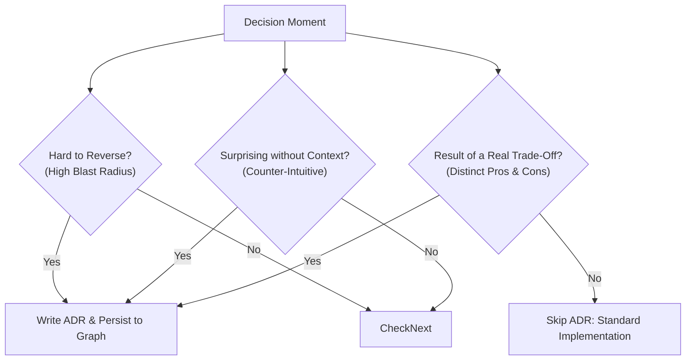

# Architecture Decision Records (ADRs)

Capture significant architectural decisions as they happen during development sessions. Instead of decisions vanishing into ephemeral chat transcripts or PR threads, this skill produces structured ADR documents that live alongside code in git, aligns domain terminology with `GLOSSARY.md`, and persists `(:Episodic)-[:DECIDES]->(:ADR)` knowledge graph nodes in FalkorDB.

---

## When to Write an ADR

Do NOT write ADRs for trivial implementation details, bug fixes, or minor styling preferences. Write an ADR whenever a decision meets one or more of these criteria:



### 1. Hard to Reverse
- Foundational architectural patterns (e.g., event sourcing vs. CRUD, microservices vs. monolith)
- Primary datastores, persistence tiers, or vector indexing engines (e.g., FalkorDB + Qdrant)
- Core IPC / RPC communication protocols (e.g., Unix domain sockets vs. loopback TCP)
- Invariants with massive blast radius across dozens of modules

### 2. Surprising Without Context
- Deliberate departures from common industry conventions
- Unintuitive constraints necessary for safety or performance (e.g., FastMCP Sole Custodian model prohibiting direct embedded Qdrant instantiations to prevent SQLite file-lock deadlocks)
- Architectural workarounds for hardware, OS, or kernel limitations

### 3. Result of a Real Trade-Off
- Choosing between two or more viable, mature technical alternatives
- Decisions where every option has legitimate downsides (e.g., consistency vs. latency, memory footprint vs. CPU speed)
- Never write an ADR when there was only one obvious path with no meaningful alternative

---

## Domain Terminology Modeling & `GLOSSARY.md` Alignment

Architectural clarity requires unambiguous domain language:

1. **Challenge Ambiguous Terms Early:**
   - Probe fuzzy or overloaded terms during planning (e.g., "cache", "session", "context", "gateway").
   - Define exact operational semantics before codifying decisions.
2. **Align with `GLOSSARY.md`:**
   - Every ADR must reference canonical terminology defined in `GLOSSARY.md`.
   - If an ADR introduces a new architectural concept (e.g., "Sole Custodian", "Causal Sanitizer", "Weibull Retention Decay"), document the term directly in the ADR and add/update its definition in `GLOSSARY.md`.
3. **Prevent Semantic Drift:**
   - Ensure the same term is used consistently across code identifiers, test fixtures, agent instructions, and graph memory payloads.

---

## Standard ADR Document Structure

Store ADRs in `docs/adr/NNNN-[title].md` using Michael Nygard's format, enhanced for AI-assisted systems:

```markdown
# ADR-NNNN: [Decision Title]

**Date**: YYYY-MM-DD
**Status**: proposed | accepted | deprecated | superseded by ADR-XXXX
**Deciders**: [Engineers / Agents involved]
**Domain Terms**: [List of canonical terms defined or aligned with GLOSSARY.md]

## Context

What is the situation, technical challenge, and operational context driving this decision?

[2-5 sentences describing the problem, constraints, latency/memory requirements, and invariants]

## Decision

What technical approach are we committing to?

[1-3 sentences stating the decision clearly, using ubiquitous domain terms from GLOSSARY.md]

## Domain Modeling

- **[Term 1]**: [Exact definition and system boundary]
- **[Term 2]**: [Exact definition and system boundary]

## Alternatives Considered

### Alternative 1: [Name of Alternative]
- **Pros**: [Key benefits]
- **Cons**: [Key drawbacks]
- **Why Not**: [Definitive reason this option was rejected]

### Alternative 2: [Name of Alternative]
- **Pros**: [Key benefits]
- **Cons**: [Key drawbacks]
- **Why Not**: [Definitive reason this option was rejected]

## Consequences

What becomes easier or harder because of this change?

### Positive
- [Benefit 1]
- [Benefit 2]

### Negative & Trade-offs
- [Trade-off 1]
- [Trade-off 2]

### Risks & Mitigations
- **Risk**: [Specific failure mode]
  - **Mitigation**: [Guard, invariant, or architectural defense]
```

---

## Kortext Superpower: Knowledge Graph & Episodic Persistence

ADRs must not remain dead markdown files on disk. Persist accepted decisions directly into the Kortext FalkorDB graph and Qdrant vector store.

### 1. Dual Episodic Persistence
When an ADR is accepted, persist it via `record_system_outcome`:

```python
record_system_outcome(
    decision="ADR-0004: FastMCP Sole Custodian Model for Vector Indexing",
    rationale=(
        "Selected FastMCP Sole Custodian over direct embedded Qdrant clients. "
        "Eliminates SQLite/RocksDB LOCK_EX concurrency crashes across subagents. "
        "Aligned domain terms with GLOSSARY.md: 'Sole Custodian', 'Advisory Lock Contention'."
    ),
    category="decision",
)
```

### 2. Graph Topology Created
Under the hood, this creates a rich semantic subgraph in FalkorDB:
```
(:Episodic {id: '...', timestamp: '...'})
    -[:DECIDES]-> (:ADR {number: 4, title: 'FastMCP Sole Custodian Model', status: 'accepted'})
    -[:AFFECTS]-> (:CodeSymbol {name: 'QdrantCustodian'})
```

### 3. Cross-Session Semantic Retrieval
Future developer and agent turns can retrieve the rationale immediately via RAG without searching git log:
```python
search_knowledge_and_memory(
    query="why do we prohibit direct QdrantClient instantiations?",
    collection="kortext"
)
```

---

## ADR Lifecycle

```
proposed ──► accepted ──┬──► deprecated
                        └──► superseded by ADR-NNNN
```

- **`proposed`**: Under active discussion or review. Not yet in effect.
- **`accepted`**: Decided, approved, and actively enforced in production code.
- **`deprecated`**: No longer applicable (e.g., deprecated subsystem decommissioned).
- **`superseded by ADR-NNNN`**: Overridden by a subsequent ADR. Always link the successor.

---

## Workflow: Capturing an ADR

1. **Detect Decision Moment:**
   - Detect explicit triggers: *"Let's record an ADR"*, *"We decided to..."*, *"The reason we chose X is..."*.
   - Detect implicit triggers: User evaluates two architectural approaches and selects one.
2. **Draft & Align Domain Terms:**
   - Formulate Context, Decision, Alternatives, and Consequences.
   - Cross-check domain terminology with `GLOSSARY.md`.
3. **Confirm with User:**
   - Present the draft ADR to the user for review.
   - Do not write files to disk without explicit approval.
4. **Write ADR & Update Index:**
   - Determine next sequence number (e.g. `0004`).
   - Write to `docs/adr/0004-[slug].md`.
   - Update table in `docs/adr/README.md`.
5. **Persist to Graph Memory:**
   - Call `record_system_outcome(category="decision", ...)` to register the decision in FalkorDB and Qdrant.

---

## Anti-Patterns to Avoid

| Anti-Pattern | Failure Mode | Correct Approach |
|---|---|---|
| **ADR for Trivial Details** | Bloats documentation with variable names and utility choices. | Only write when Hard to Reverse, Surprising, or a Real Trade-Off. |
| **No Alternatives Listed** | Future engineers cannot tell if other options were evaluated. | Document at least 1-2 realistic alternatives with "Why Not". |
| **Ambiguous Terminology** | Different modules use conflicting definitions for core concepts. | Align with `GLOSSARY.md` and define domain entities explicitly. |
| **Stale ADRs** | Outdated decisions mislead developers. | Mark obsolete ADRs as `superseded by ADR-NNNN` with links. |
| **Disconnected Markdown** | Decisions get lost in git history and forgotten by agent sessions. | Persist via `record_system_outcome(category='decision', ...)`. |

---

## Verification Checklist

Before finalizing an ADR:
- [ ] Decision satisfies at least one criteria (Hard to Reverse, Surprising, Real Trade-Off)
- [ ] Context clearly describes motivating forces and operational constraints
- [ ] Domain terminology is verified and aligned with `GLOSSARY.md`
- [ ] At least one concrete alternative documented with specific rejection rationale
- [ ] Consequences cover positive benefits, negative trade-offs, and risk mitigations
- [ ] Status is set correctly (`proposed`, `accepted`, `superseded`)
- [ ] Persisted to FalkorDB episodic memory via `record_system_outcome`
