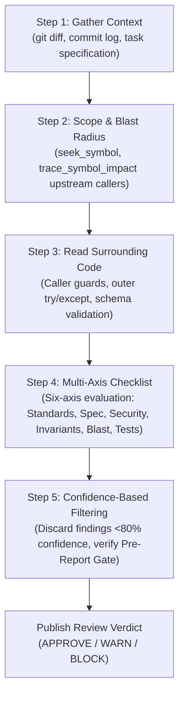
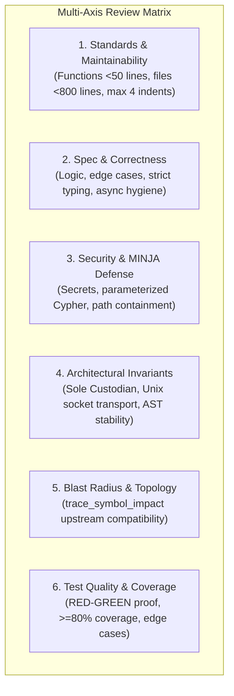

# Multi-Axis Code Review & Blast-Radius Protocol for Kortext

This skill defines the rigorous code review protocol required for all code modifications, refactorings, and feature additions in Kortext. It pairs enterprise review standards from ECC (`code-reviewer`, `rules/common/code-review`) with Kortext's FalkorDB AST symbol index and graph-backed blast-radius impact analysis.

---

## When to Activate

Review is **mandatory** during:
- Post-implementation verification prior to creating git commits (Pre-Commit Gate).
- Architectural and invariant audits prior to calling `record_system_outcome` (Pre-Persistence Gate).
- Before merging pull requests or completing nodes in the Task DAG (`manage_tasks: status=completed`).
- Any refactoring, renaming, or signature modification of shared symbols.
- Security-sensitive modifications (authentication, memory persistence, substrate socket communication).

---

## The 5-Step Code Review Process

Reviews must execute sequentially through five structured steps to eliminate superficial critiques and maximize finding accuracy:



### Step 1: Gather Context
- Run `git diff` against base branch (`HEAD~1` or `origin/main`).
- Review the motivating task specification or Task DAG entry (`manage_tasks`).
- Identify the explicit problem the author intended to solve.

### Step 2: Understand Scope & Blast Radius
- Never use text search (`grep`, `rg`) to locate modified symbols.
- Use `seek_symbol(symbol_name="<Target>")` to inspect modified signatures and exact AST boundaries.
- Run `trace_symbol_impact(symbol="<Target>", direction="upstream")` to identify every caller that could be affected by signature changes, new parameters, or modified return types.

### Step 3: Read Surrounding Code
- **Never evaluate changed lines in isolation.** Read 20-50 lines before and after the diff.
- Inspect caller guards: Is an apparent missing check already handled by an upstream caller or framework middleware?
- Check framework error boundaries: Does FastAPI or the server loop automatically handle the exception?

### Step 4: Apply Multi-Axis Checklist
- Evaluate the diff against the **Six-Axis Review Matrix** (Standards, Correctness, Security, Invariants, Blast Radius, Tests).

### Step 5: Confidence-Based Filtering
- Apply the **>80% Confidence Rule**: If you cannot prove with $>80\%$ certainty that a finding is a real defect that will trigger under concrete inputs, **discard it**.
- Zero manufactured findings: A clean review with 0 findings is valid and expected when code meets all criteria.

---

## The Six-Axis Review Matrix



### Axis 1: Standards & Maintainability
- **Focused Functions:** Single-purpose and $<50$ lines.
- **Cohesive Files:** Below the 800-line soft ceiling. Larger files require modular decomposition.
- **Nesting Depth:** Maximum 4 levels of indentation. Use guard clauses and early returns.
- **Hygiene:** Zero dead code, debug statements (`print()`, `console.log`), or unlinked `TODO` comments.

### Axis 2: Specification & Correctness
- **Algorithmic Correctness:** Fulfills requirements without off-by-one errors or infinite loops.
- **Strict Typing:** All signatures and return types explicitly typed. Avoid `Any` or `unknown`.
- **Async/Await Correctness:** No missing `await`, unhandled Promise rejections, or blocking synchronous I/O in async routines.
- **Explicit Error Handling:** Typed exceptions caught at appropriate boundaries. No blanket `except Exception: pass`.

### Axis 3: Security & Injection Defense
- **Secrets:** Zero hardcoded credentials or tokens. All config from environment variables.
- **Parameterized Queries:** Zero string concatenation or f-strings in FalkorDB Cypher or SQL. Always use `$param` syntax.
- **MINJA Causal Defense:** All proposed memory assertions must pass through `CausalSanitizer` before persistence.
- **Path & Command Confinement:** Strict path validation with `is_relative_to(base_dir)`. Subprocess calls must use argument lists with `shell=False`.

### Axis 4: Architectural Invariants
- **Sole Custodian Invariant:** Only the FastMCP daemon (`kortext.server`) owns direct substrate write handles. External scripts must never instantiate direct database write handles.
- **Substrate Resilience:** Connect via Unix Domain Socket (`~/.kortext/run/falkordb.sock`) with TCP (`127.0.0.1:6379`) loopback fallback.
- **AST Hash Stability:** Check modified symbols against invariant definitions in `journal/invariants.md`.

### Axis 5: Blast Radius & Graph Topology
- **Multi-Hop Dependency Analysis:** Run `trace_symbol_impact(symbol="<Name>", direction="upstream")` on every modified symbol.
- **Call-Site Compatibility:** Confirm all upstream callers are updated to match modified signatures.
- **Decoupling:** Zero circular dependencies in the symbol graph.

### Axis 6: Test Quality & Verification
- **TDD Proof:** Demonstrable failing test (RED) prior to implementation, passing test (GREEN) after.
- **Coverage:** Minimum 80% line and branch coverage on newly introduced or modified logic.
- **Boundary Tests:** Edge cases, empty inputs, nulls, and exception handling branches covered.

---

## Review Severity Categories

| Severity | Criteria & Impact | Required Action | Example |
|---|---|---|---|
| **CRITICAL** | Security vulnerabilities (injection, hardcoded keys), data loss/corruption, substrate lock conflicts, MINJA causal bypass, broken architectural invariants. | **BLOCKS merge.** Must be resolved before proceeding. | Unparameterized Cypher query: `f"MATCH (n) WHERE n.name='{input}'"` |
| **HIGH** | Functional bugs in nominal paths, broken caller contracts, unhandled exceptions crashing workers, missing authorization checks, zero test coverage. | **BLOCKS merge.** Fix required before PR approval. | Renamed function parameter breaking 4 upstream callers identified via `trace_symbol_impact`. |
| **MEDIUM** | Performance anti-patterns ($O(N^2)$ algorithmic complexity), missing edge-case validation, missing type annotations on shared functions, unhandled boundary values. | Should be fixed or tracked in Task DAG before final persistence. | Missing timeout on external HTTP client call. |
| **LOW** | Minor style inconsistencies, non-standard naming, typos in docstrings, missing type hints on internal local helpers. | Non-blocking. Author may address at discretion. | Inconsistent variable naming in local helper function. |

---

## Confidence-Based Filtering & Pre-Report Gate

Before authoring any finding, validate against the **Pre-Report Gate**. If any check fails, **discard or downgrade** the finding:

```
┌────────────────────────────────────────────────────────┐
│                   PRE-REPORT GATE                      │
├────────────────────────────────────────────────────────┤
│ 1. Confidence > 80%? Is this a proven, concrete bug?   │
│ 2. Can I cite the exact file and line number span?     │
│ 3. Can I describe the concrete failure scenario        │
│    (exact input + state + bad outcome)?                │
│ 4. Have I read surrounding context and caller guards?  │
│ 5. Is the severity defensible without inflation?       │
└────────────────────────────────────────────────────────┘
```

### Common False Positives to Skip

Do **NOT** report findings for the following patterns:

| Pattern | Why It Is a False Positive | What to Do |
|---|---|---|
| **Framework Error Handling** | FastAPI, Starlette, or FastMCP automatically catch and format unhandled exceptions into HTTP 500 responses. | Do not report missing try/except if framework handles it. |
| **Internal / Pre-Validated Inputs** | Internal private helper functions (`_helper()`) receive parameters that were already validated at the public API boundary. | Verify caller guards first; do not demand duplicate validation. |
| **Standard HTTP / Status Numbers** | Status codes like `200`, `201`, `400`, `404`, `500`, default ports `6379`, `8000`, standard exit codes `0`, `1`, retry counts `3`. | Do not flag as "magic numbers" requiring constants. |
| **Type Coercion via Pydantic** | Pydantic v2 schemas automatically coerce and validate types (e.g., string to int, ISO strings to datetime). | Do not report manual type checks as missing. |
| **Test Fixtures & Mocks** | Dummy passwords (`"testpassword"`), localhost URLs, and relaxed assertions inside `tests/` directories. | Do not flag test fixtures as hardcoded secrets. |
| **Idiomatic Guard Clauses** | Python `getattr(obj, "prop", None)` or TypeScript `obj?.prop` intentionally returning `None`/`undefined`. | Do not flag as unhandled null dereferences. |

---

## Tool-Assisted Review Workflow

```python
# 1. Deterministically inspect modified symbol
declaration = seek_symbol(symbol_name="CausalSanitizer")

# 2. Audit upstream blast radius (callers who will break)
upstream = trace_symbol_impact(
    symbol="CausalSanitizer",
    direction="upstream",
    max_depth=3
)

# 3. Audit downstream dependencies
downstream = trace_symbol_impact(
    symbol="CausalSanitizer",
    direction="downstream",
    max_depth=2
)
```

---

## Standard Code Review Report Template

```markdown
# Code Review: <Task ID / PR Title>

**Reviewer**: <Agent Name / Role>
**Timestamp**: <ISO-8601 Date>
**Files Audited**: <List of file paths>

## 1. Multi-Axis Audit Matrix

| Axis | Status | Key Observations |
|---|---|---|
| Standards & Maintainability | PASS / WARN / FAIL | <Summary of file size, nesting, naming> |
| Specification & Correctness | PASS / WARN / FAIL | <Summary of logic, edge cases, typing> |
| Security & MINJA Defense    | PASS / WARN / FAIL | <Secrets, Cypher $params, sanitization> |
| Architectural Invariants   | PASS / WARN / FAIL | <Substrate resilience, sole custodian> |
| Blast Radius & Topology    | PASS / WARN / FAIL | <trace_symbol_impact upstream status> |
| Test Quality & Coverage     | PASS / WARN / FAIL | <RED-GREEN evidence, coverage percentage> |

## 2. Blast Radius & Interface Verification

- **Target Symbol**: `<SymbolName>`
- **Upstream Callers Checked**: `<Count of callers identified via trace_symbol_impact>`
- **Interface Contract**: `<seek_symbol signature verification outcome>`
- **Breaking Changes Detected**: <None / Details>

## 3. Findings

### [CRITICAL | HIGH | MEDIUM | LOW] <Finding Title>
- **Location**: `file:///path/to/file.py#L42-L48`
- **Confidence**: <80% - 100%>
- **Failure Scenario**: <Concrete input + state + catastrophic outcome>
- **Why Caller Guards Fail**: <Why types or existing handlers do not catch this>
- **Required Fix**:
```python
# Provide drop-in replacement snippet
```

---

## 4. Review Summary & Verdict

| Severity | Count | Status |
|---|---|---|
| CRITICAL | 0 | PASS |
| HIGH | 0 | PASS |
| MEDIUM | 0 | PASS |
| LOW | 0 | PASS |

**Verdict**: **APPROVE** (All critical quality gates passed; ready for pre-persistence recording.)
```

### Verdict Definitions
- **APPROVE**: Zero CRITICAL and zero HIGH issues. Code meets all six axes, passes unit tests, respects blast-radius limits, and is safe for `record_system_outcome`.
- **WARN / REQUEST CHANGES**: Zero CRITICAL issues, but one or more HIGH issues exist (e.g., missing test coverage, uncovered blast-radius callers). Fixes required before merge.
- **BLOCK**: Any CRITICAL issue found (hardcoded credentials, Cypher/SQL injection, MINJA bypass, substrate lock conflict, or invariant breakage). Immediate rollback or remediation required.
