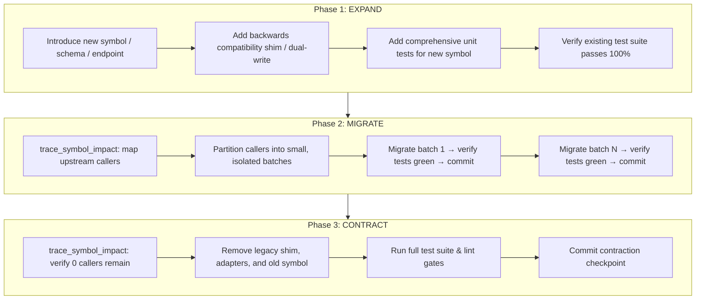

# Expand-Contract Refactoring Protocol

A compiler-grade, zero-downtime refactoring protocol for mutating shared interfaces, database schemas, API routes, and core codebase symbols without breaking downstream consumers or triggering CI regressions.

## When to Activate

- Modifying function/method signatures used across multiple modules ($N \ge 3$ call sites)
- Renaming or restructuring public interfaces, classes, types, or protocols
- Migrating database tables, columns, or vector store payload schemas
- Evolving REST endpoints, FastMCP tool definitions, or IPC socket protocols
- Breaking architectural changes where instant "big-bang" edits risk cascading failures

---

## The 3-Phase Lifecycle



---

## Kortext Superpower: AST Graph Traversal

Never rely on brute-force text search (`grep`, `ripgrep`) to find callers or gauge blast radius. Grep matches comments, strings, and variable name collisions while missing dynamic imports.

Use the Kortext AST B-Tree index and FalkorDB symbol graph:

### 1. Map Complete Caller Graph
```python
# Discover all upstream callers and blast radius (<5ms)
trace_symbol_impact(symbol="OldRepository", direction="upstream")
```
This returns:
- Exact file paths and line ranges for every call site
- Caller hierarchy and package boundaries
- In-degree centrality (how heavily used the symbol is)

### 2. Inspect Target Symbols Deterministically
```python
# Direct Tree-sitter AST point lookup (<2ms, ~120 tokens)
seek_symbol(symbol_name="OldRepository")
```

### 3. Partition Callers by Graph Clusters
Partition migration batches based on graph clusters:
- **Batch 1 (Leaf callers):** Independent utility functions or leaf nodes with zero downstream dependents.
- **Batch 2 (Internal callers):** Sibling domain modules within the same package.
- **Batch 3 (External callers):** Cross-subsystem integrations, API routes, and handlers.

---

## Phase-by-Phase Execution Guide

### Phase 1: Expand

Goal: Introduce the new capability alongside the old one while keeping existing code 100% operational.

1. **Author the New Abstraction:**
   - Define the new symbol with desired typing, parameter layout, and immutability.
   - Do NOT modify or delete the existing symbol yet.
2. **Implement Backwards-Compatible Forwarding:**
   - Wire the legacy symbol to delegate to the new implementation, or wrap the new implementation in a legacy adapter.
   - For database schemas: Add new nullable/defaulted columns or dual-write triggers.
3. **Write Unit Tests for the New Symbol:**
   - Write tests exercising all new interfaces and edge cases.
   - Run the test suite:
     ```bash
     uv run pytest -q
     ```
   - Both old tests and new tests MUST pass cleanly.
4. **Checkpoint Commit:**
   ```bash
   git commit -m "feat: expand <symbol> with backwards-compatible interface"
   ```

#### Example: Python Function Signature Expand
```python
# BEFORE (Legacy)
def calculate_retention(strength: float, elapsed: float) -> float:
    return strength * (0.5 ** (elapsed / 86400.0))

# AFTER EXPAND (Phase 1)
from dataclasses import dataclass

@dataclass(frozen=True)
class DecayParameters:
    strength: float
    elapsed_seconds: float
    shape_k: float = 0.5
    scale_lambda: float = 86400.0

def compute_retention_v2(params: DecayParameters) -> float:
    """New canonical implementation using Weibull parameters."""
    return params.strength * (params.shape_k ** (params.elapsed_seconds / params.scale_lambda))

def calculate_retention(strength: float, elapsed: float) -> float:
    """DEPRECATED: Legacy shim forwarding to compute_retention_v2."""
    import warnings
    warnings.warn(
        "calculate_retention is deprecated; use compute_retention_v2 with DecayParameters",
        DeprecationWarning,
        stacklevel=2,
    )
    return compute_retention_v2(
        DecayParameters(strength=strength, elapsed_seconds=elapsed)
    )
```

---

### Phase 2: Migrate

Goal: Incrementally update callers in small, testable batches without long-lived broken branches.

1. **Inspect Upstream Call Sites:**
   Call `trace_symbol_impact(symbol="<old_symbol>", direction="upstream")`.
2. **Sort and Batch Call Sites:**
   - Group call sites into batches of 3–5 callers maximum.
   - Batch by module cohesion (e.g., all test callers first, or all repository callers first).
3. **Migrate Batch $N$:**
   - Update call sites within Batch $N$ to invoke the new symbol.
   - Run verification immediately:
     ```bash
     uv run pytest path/to/affected_module_test.py
     uv run pytest -q
     ```
4. **Checkpoint Commit per Batch:**
   ```bash
   git commit -m "refactor: migrate batch $N$ callers of <old_symbol> to <new_symbol>"
   ```
5. **Repeat until all batches are migrated.**

---

### Phase 3: Contract

Goal: Safely eliminate dead code, legacy adapters, and technical debt once all consumers have migrated.

1. **Verify Zero Callers Remain:**
   Execute `trace_symbol_impact(symbol="<old_symbol>", direction="upstream")`.
   Confirm that the upstream caller list is strictly empty:
   ```
   upstream_callers: []
   ```
2. **Remove the Deprecated Symbol:**
   - Delete the legacy function, adapter shim, or deprecated route.
   - Remove any temporary deprecation warning handlers or compatibility flags.
3. **Clean Up Database / Storage (if applicable):**
   - For database columns: Issue migration dropping the old column after backfill verification.
   - For vector stores: Prune deprecated payload keys.
4. **Final Verification Gate:**
   - Run the complete project test suite:
     ```bash
     uv run pytest -q
     ```
   - Run manifest and lint checks:
     ```bash
     python3 scripts/test_plugin_manifest.py
     uv run ruff check .
     ```
5. **Contract Checkpoint Commit:**
   ```bash
   git commit -m "refactor: contract <old_symbol>, remove deprecated implementation"
   ```
6. **Persist Refactoring Outcome in Episodic Memory:**
   ```python
   record_system_outcome(
       decision="Contracted <old_symbol> in favor of <new_symbol>",
       rationale="Completed 3-phase expand-contract refactoring across N call sites with zero downtime.",
       category="refactor",
   )
   ```

---

## Domain Patterns

### 1. Database Schema Migrations
- **Expand:** Add new column `user_id_v2` with `NULL` permitted or default value. Application dual-writes to both `user_id` and `user_id_v2`.
- **Migrate:** Backfill historical rows from `user_id` to `user_id_v2`. Switch application reads to `user_id_v2`.
- **Contract:** Remove dual-writing code. Drop `user_id` column.

### 2. FastMCP Tool / API Route Migrations
- **Expand:** Expose new tool `search_knowledge_and_memory` alongside deprecated `query_memory`. Deprecated tool wraps new tool internally.
- **Migrate:** Update client agents and caller prompts to invoke `search_knowledge_and_memory`.
- **Contract:** Remove `query_memory` definition from MCP server tool registration.

---

## Anti-Patterns to Avoid

| Anti-Pattern | Why It Fails | Correct Approach |
|---|---|---|
| **Big-Bang Rename** | Renaming across 40 files in 1 commit breaks CI, creates merge conflicts, and obscures regressions. | Expand with shim, migrate in batches of 3-5, contract cleanly. |
| **Grep Hunting** | Ripgrep misses aliased imports, matches comments/strings, and bleeds context tokens. | Use `trace_symbol_impact(symbol, direction='upstream')`. |
| **Premature Contraction** | Deleting the old symbol while lingering dynamic callers or tests still reference it causes runtime crashes. | Verify `upstream_callers == []` via AST graph before removing. |
| **Unversioned Dual-Write** | Dual-writing without idempotency or reconciliation causes silent state drift. | Use immutable data structures and explicit verification assertions. |
| **Skipping Inter-Batch Tests** | Migrating multiple batches without running tests between them makes diagnosing failure points difficult. | Run `uv run pytest -q` after every single batch commit. |

---

## Verification Checklist

Before declaring an expand-contract refactor complete:
- [ ] Phase 1 (Expand): New symbol introduced with backwards-compatible shim
- [ ] Phase 1 (Expand): Unit tests cover new symbol with 100% green pass rate
- [ ] Phase 2 (Migrate): Callers mapped via `trace_symbol_impact`
- [ ] Phase 2 (Migrate): Call sites migrated incrementally in batches
- [ ] Phase 2 (Migrate): Tests pass after every batch migration
- [ ] Phase 3 (Contract): `trace_symbol_impact` confirms 0 callers remain
- [ ] Phase 3 (Contract): Legacy shim removed and full test suite passes 100%
- [ ] Phase 3 (Contract): Refactoring outcome persisted via `record_system_outcome`
