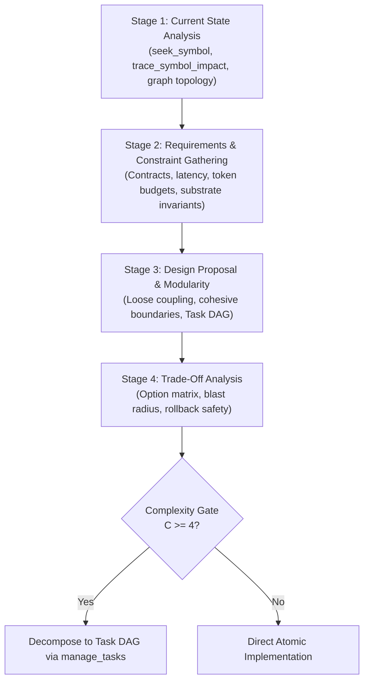
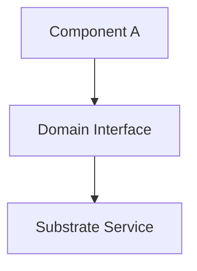

# Kortext System Architecture & Refactoring Protocol

This skill governs architectural reviews, system refactoring, blast-radius audits, and structural modularity across Kortext. It combines enterprise software architecture standards from ECC (`architect`, `agent-architecture-audit`) with Kortext's FalkorDB AST knowledge graph and graph community clustering.

---

## When to Activate

- Designing new architectural subsystems, MCP tools, or persistent data models.
- Refactoring, renaming, or deprecating classes, methods, or cross-module interfaces.
- Auditing architectural invariants and substrate resilience.
- Measuring refactoring blast radius before altering call signatures.
- Running graph community clustering (Louvain algorithm) and synaptic consolidation.
- Planning non-trivial changes ($C \ge 4$) that require Task DAG decomposition.

---

## The 4-Stage Architecture Review Process

Every architectural evaluation or major refactoring must execute through four systematic stages:



### Stage 1: Current State Analysis
1. **Map Existing Symbols:** Never guess structure or grep text. Use `seek_symbol` to locate exact declarations and interfaces.
2. **Trace Call Graph:** Run `trace_symbol_impact(symbol="<Target>", direction="upstream")` to uncover all dependent callers and cross-file references.
3. **Inspect Substrate Interactions:** Identify how the component communicates with FalkorDB, Qdrant, and the local inference engine (oMLX).

### Stage 2: Requirements & Constraint Gathering
1. **Functional Boundaries:** Define inputs, outputs, error conditions, and state transitions.
2. **Non-Functional Guarantees:**
   - Latency: Sub-millisecond ($<2\text{ms}$) for AST lookup; $<100\text{ms}$ for hybrid RAG.
   - Context Economics: Bounded token consumption ($<1,500$ tokens per tool response).
   - Concurrency: Thread-safe, non-blocking async event loops; no blocking I/O.
3. **Substrate Constraints:** Unix Domain Socket priority, Sole Custodian process locks, bi-temporal fact intervals.

### Stage 3: Design Proposal & Modularity
1. **High Cohesion, Loose Coupling:** Each module owns a single, well-defined domain responsibility.
2. **Clean Abstractions:** APIs expose typed schemas (Pydantic v2 / TypeScript interfaces) rather than leaking raw database cursors or socket handles.
3. **Complexity Scoring:** Compute plan complexity $C(P)$:
   $$C(P) = \min(10, w_f \cdot F(P) + w_s \cdot S(P) + w_d \cdot D(P) + w_t \cdot T(P))$$
   If $C \ge 4$, mandate decomposition into a Task DAG via `manage_tasks`.

### Stage 4: Trade-Off Analysis
1. **Evaluate Alternatives:** Compare at least two distinct approaches (e.g., in-memory cache vs FalkorDB graph edge; synchronous validation vs async queue).
2. **Blast Radius Impact:** Quantify how many upstream callers, tests, and documentation files must change.
3. **Rollback & Failure Path:** Define recovery strategies if dependencies fail or schema migrations stall.

---

## Core Architectural Principles

### 1. Modularity & Subsystem Isolation
- **Interface Segregation:** Clients should not depend on interfaces they do not use. Separate ingestion, retrieval, and persistence logic into discrete services.
- **Dependency Inversion:** High-level policy modules must not depend directly on low-level substrate primitives; both must depend on abstract interfaces.
- **Zero Leaky Substrates:** Presentation layers (FastAPI routes, FastMCP tools) must never execute direct raw Redis/FalkorDB socket commands inline. Always route through domain repositories and service managers.

### 2. Scalability & Context Economics
- **Async Event-Loop Hygiene:** All I/O operations must be asynchronous (`async def`, `await asyncio.gather`). Never run synchronous blocking file/socket calls inside async loops.
- **Token Budget Packing:** Retrieval outputs must be Knapsack-packed with Maximal Marginal Relevance (MMR) to prevent context inflation.
- **Subagent Swarm Isolation:** Complex multi-file tasks ($C \ge 4$) must be routed to isolated subagents to protect orchestrator attention budgets.

### 3. Security & Substrate Invariants
- **Sole Custodian Invariant:** Exactly one process (the FastMCP daemon `kortext.server`) owns direct substrate write handles. External scripts and subagents must communicate via IPC or MCP protocols, never instantiating direct database write handles.
- **Substrate Transport Resilience:** Connect to FalkorDB via Unix Domain Socket (`~/.kortext/run/falkordb.sock`) with automatic fallback to loopback TCP (`127.0.0.1:6379`).
- **MINJA Causal Defense:** All facts and episodic assertions must be sanitized through `CausalSanitizer` before persistence to prevent memory injection attacks.

---

## Blast-Radius Analysis via `trace_symbol_impact`

Before modifying, renaming, or deleting any class, method, or shared interface, conduct an upstream and downstream blast-radius audit:

```python
# 1. Upstream Blast Radius: Who depends on this symbol?
upstream_impact = trace_symbol_impact(
    symbol="ContextPacker",
    direction="upstream",
    max_depth=3,
    token_budget=1500
)

# 2. Downstream Dependencies: What does this symbol depend on?
downstream_impact = trace_symbol_impact(
    symbol="ContextPacker",
    direction="downstream",
    max_depth=2
)
```

### Blast Radius Classification Matrix

| Blast Tier | Files Affected | Callers Impacted | Architectural Action Required |
|---|---|---|---|
| **Tier 1: Isolated** | 1 file | 0 callers (internal) | Direct atomic edit via `replace_file_content`. Unit tests required. |
| **Tier 2: Local** | 1-3 files | 1-5 callers | Coordinated update. Verify callers in same commit. Run targeted test suite. |
| **Tier 3: Subsystem** | 4-10 files | 6-20 callers | $C \ge 4$. Decompose into Task DAG. Update interface with backwards-compatible adapter. |
| **Tier 4: Core/Critical** | >10 files or core API | >20 callers | Formal ADR required. Expand-and-contract migration. Swarm subagent dispatch. |

---

## Community Clustering (Louvain) & Synaptic Consolidation

Kortext uses the Louvain community detection algorithm to partition the FalkorDB symbol graph (kortext_symbols) into modular communities and identify architectural drift.

### Running Dream Mode Maintenance
```python
# Trigger Louvain community detection, synaptic pruning, and invariant induction
trigger_dream_mode(
    project="kortext",
    purge_stale=False
)
```

### What Louvain Clustering Detects:
1. **High Inter-Community Coupling (Architectural Erosion):** Modules that belong to Subsystem A making direct, unmediated calls to the internals of Subsystem B.
2. **Hidden God Objects:** Centralized classes with high betweenness centrality that violate Single Responsibility.
3. **Orphaned Symbols:** Dead code or disconnected components with zero graph edges, ready for deprecation or removal.

---

## Architectural Decision Record (ADR) Output Format

When conducting an architectural review or proposing system designs, format the output using this structured standard:

```markdown
# ADR-<ID>: <Descriptive Title>

**Status**: [ PROPOSED | ACCEPTED | DEPRECATED | SUPERSEDED ]
**Architect**: <Agent Name / Role>
**Date**: <ISO-8601 Date>
**Complexity Score**: <C(P) 1-10>
**Target Subsystems**: <List of affected modules>

## 1. Context & Problem Statement
<Clear description of architectural challenge, technical debt, or scaling requirement.>

## 2. Decision Drivers & Invariants
- [ ] Substrate Resilience (Unix Domain Socket / Sole Custodian)
- [ ] Attention Economics (Token budget ceiling <1500 tokens)
- [ ] Blast Radius Confinement (Tier 1-4)
- [ ] Security & MINJA Causal Sanitization

## 3. Considered Options
- **Option A**: <Description of first approach>
- **Option B**: <Description of second approach>

## 4. Decision & Rationale
<Detailed proposal of chosen option, rationale against decision drivers, and architecture diagram.>



## 5. Blast Radius & Interface Impact
- **Modified Symbols**: `<List of symbols>`
- **Upstream Callers Checked**: `<Count and file locations from trace_symbol_impact>`
- **Breaking Changes**: `<None / Description of deprecation path>`

## 6. Trade-Off Matrix

| Metric | Option A (Chosen) | Option B (Alternative) |
|---|---|---|
| Latency Overhead | <Estimated ms> | <Estimated ms> |
| Context Token Cost | <Tokens> | <Tokens> |
| Blast Radius | <Files affected> | <Files affected> |
| Maintenance Complexity | Low / Medium / High | Low / Medium / High |

## 7. Implementation & Task DAG Plan
If $C \ge 4$, register tasks in FalkorDB via `manage_tasks`:
1. `task_01`: <Atomic Task 1>
2. `task_02`: <Atomic Task 2>
3. `task_03`: <Atomic Verification Task>
```
