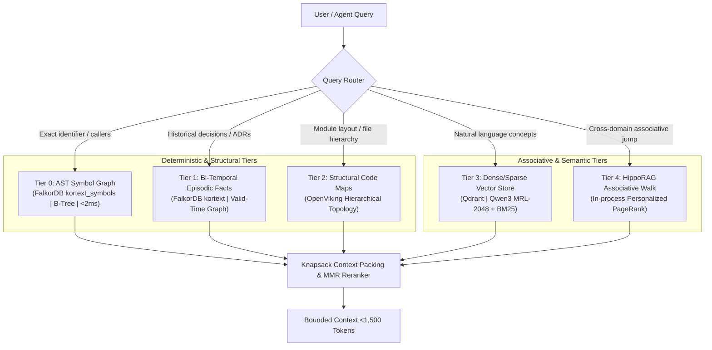

# Kortext 5-Tier Dual-Memory & Retrieval Guide

This skill governs contextual retrieval, memory querying, token efficiency, and substrate diagnostics across Kortext. It aligns ECC retrieval best practices (`iterative-retrieval`, `rag-pipeline-reviewer`) with Kortext's 5-signal cognitive memory substrate.

---

## 1. System Topology: The 5-Signal Memory Architecture

Kortext organizes codebase knowledge, episodic decisions, and entity relationships across five complementary tiers:



### The 5 Memory Tiers Breakdown

| Tier | Substrate / Engine | Index Structure | Latency | Primary Query Tool | Use Case |
|---|---|---|---|---|---|
| **Tier 0** | FalkorDB `kortext_symbols` | Tree-sitter AST, B-Tree indexes | $<2\text{ms}$ | `seek_symbol`, `trace_symbol_impact` | Jump-to-definition, caller graphs, exact line ranges |
| **Tier 1** | FalkorDB `kortext` | Bi-temporal entity graph | $<5\text{ms}$ | `search_knowledge_and_memory` | Past decisions, ADRs, episodic task outcomes |
| **Tier 2** | OpenViking | Hierarchical directory summaries | $<10\text{ms}$ | `search_knowledge_and_memory` | Subsystem topology, package layouts, domain maps |
| **Tier 3** | Embedded Qdrant | Dense (Qwen3 MRL) + Sparse (BM25) | $<50\text{ms}$ | `search_knowledge_and_memory` | Semantic code snippets, error messages, docs |
| **Tier 4** | HippoRAG Engine | Personalized PageRank graph walk | $<80\text{ms}$ | `search_knowledge_and_memory` | Multi-hop associative discovery connecting disparate domains |

---

## 2. Iterative Retrieval Workflow

Follow ECC's iterative retrieval protocol to eliminate hallucinated context and avoid over-fetching:

```
┌────────────────────────────────────────────────────────┐
│ 1. TRIAGE INTENT & SELECT SIGNAL                       │
│    • Exact symbol name known? → Use Tier 0             │
│    • Concept / architecture / prior decision? → Tier 1-3│
├────────────────────────────────────────────────────────┤
│ 2. EXECUTE TARGETED RETRIEVAL                          │
│    • Run seek_symbol or search_knowledge_and_memory     │
├────────────────────────────────────────────────────────┤
│ 3. EVALUATE RELEVANCE & SUFFICIENCY                    │
│    • Did retrieval ground the exact files and lines?   │
│    • If ambiguous: reformulate query keywords          │
├────────────────────────────────────────────────────────┤
│ 4. SURGICAL EXTRACTION                                 │
│    • View exact lines via view_file; do not dump files │
└────────────────────────────────────────────────────────┘
```

### Step 1: Precision Symbol Search (Tier 0)
When inspecting a known function, method, or class:
```python
# Returns exact declaration, parameters, and line spans in <2ms
declaration = seek_symbol(symbol_name="InvariantGroundingEngine")

# Check callers before changing implementation
callers = trace_symbol_impact(symbol="InvariantGroundingEngine", direction="upstream")
```

### Step 2: Semantic & Associative Memory Search (Tiers 1-4)
When querying concepts, decisions, or cross-cutting features:
```python
# Unified multi-tier query with semantic reranking
context = search_knowledge_and_memory(
    prompt="How does the bi-temporal invalidation interval work during fact supersession?",
    collection="kortext"
)
```

### Step 3: Query Reformulation & Iterative Deepening
If initial retrieval yields low similarity or incomplete context:
1. **Scope to Collection:** Target specific collections using `collection="kortext_codebase"` or `collection="kortext"`.
2. **Anchor with Domain Terms:** Replace vague phrases with concrete domain terms (e.g., replace *"how memory works"* with *"FalkorDB Cypher bi-temporal valid_until interval"*).
3. **Workspace Path Scoping:** Provide `workspace_root` to narrow structural code maps.

---

## 3. Context Packing & MMR Token Economics

To prevent agent context degradation, retrieved results must be packed using **Maximal Marginal Relevance (MMR)** and strict **Knapsack token budgets**.

### MMR Formula
$$\text{MMR} = \arg\max_{d_i \in R \setminus S} \left[ \lambda \cdot \text{Sim}_1(d_i, q) - (1 - \lambda) \cdot \max_{d_j \in S} \text{Sim}_2(d_i, d_j) \right]$$
- $\lambda = 0.7$: Prioritizes high query relevance while penalizing redundant, overlapping code chunks.
- Ensures the model sees diverse perspectives (e.g., schema definition + repository implementation + integration test) rather than five copies of the same method.

### Knapsack Budgeting Rules:
- **Default Output Ceiling:** Single retrieval responses must not exceed **1,500 tokens**.
- **Adaptive Level-of-Detail (LoD):**
  - **1-Hop Callers:** Return full L1 signatures and file lines.
  - **2-Hop Callers:** Return L0 symbol names and file paths.
  - **3+ Transitive Hops:** Return aggregated counts only (e.g., `+14 transitive callers in kortext.server`).

---

## 4. Substrate Diagnostics & Degradation Recovery

When Kortext tools return empty results, errors, or timeouts, follow this diagnostic runbook:

### Step 1: Run Substrate Health Check
```python
# Check status of Qdrant, FalkorDB, and Inference Server
health = check_kortext_health()
```

### Diagnostic Checklist & Resolution Table

| Substrate | Healthy Indicator | Failure Symptom | Immediate Resolution |
|---|---|---|---|
| **FalkorDB (UDS)** | `~/.kortext/run/falkordb.sock` active | `ConnectionRefusedError: Unix socket` | Verify socket file permissions. Fall back to TCP `127.0.0.1:6379`. |
| **FalkorDB (TCP)** | Port `6379` accepting commands | `Could not connect to Redis at 127.0.0.1:6379` | Run `brew services restart falkordb` or restart Docker container. |
| **Qdrant Vector** | Port `6333` / HTTP 200 `/healthz` | `Storage locked by another process` / `502` | Verify Sole Custodian: ensure no independent script instantiated `QdrantClient(path=...)`. Restart `kortext.server`. |
| **Inference (oMLX)** | Port `8000` / HTTP 200 `/v1/models` | `Embedding service connection timeout` | Verify local embedding server: `curl http://127.0.0.1:8000/v1/models`. Launch via `omlx serve`. |

### Degraded-Mode Operational Fallbacks:
1. **If Vector Store (Qdrant) is Down:**
   - Fall back to Tier 0 AST search (`seek_symbol`) and Tier 1 FalkorDB Cypher queries. AST search operates independently of Qdrant.
2. **If Graph Database (FalkorDB) is Down:**
   - Fall back to local file inspection using `view_file` over known entry points.
3. **If Inference Server (oMLX) is Down:**
   - Vector semantic similarity is paused; use AST deterministic symbol lookup until embedding server recovers.

---

## 5. Knowledge Management: Indexing & Pruning

### Managing Vector Collections
```python
# List active vector collections and segment counts
collections = list_vector_collections()
```

### Workspace Indexing
```python
# Re-index repository into AST symbol graph and Qdrant vector store
index_directory(
    directory_path="/Users/rb/kortext",
    collection_name="kortext_codebase",
    force_reindex=False
)
```

### Superseding Stale Facts
When architectural decisions change or code contracts are superseded:
```python
# Invalidate obsolete fact and record new ground truth
delete_or_supersede_fact(
    fact_id="fact_redis_direct_socket",
    superseded_by="fact_uds_sole_custodian",
    reason="Direct redis access deprecated in favor of Sole Custodian IPC"
)
```

---

## 6. Retrieval Anti-Patterns: FAIL vs PASS

### 1. Vector Search for Known Symbol Names
```python
# FAIL: Using fuzzy vector search when symbol name is already known
search_knowledge_and_memory(prompt="Where is the class SymbolSeekEngine defined?")
```
```python
# PASS: Instant O(1) AST lookup directly in FalkorDB
seek_symbol(symbol_name="SymbolSeekEngine")
```

### 2. Dumping Full Files into Context
```python
# FAIL: Reading 1,200 lines of code after finding a symbol
view_file(AbsolutePath="/path/to/retrieval.py")
```
```python
# PASS: Reading only the symbol's bounded lines returned by seek_symbol
view_file(AbsolutePath="/path/to/retrieval.py", StartLine=142, EndLine=185)
```

### 3. Ignoring Substrate Outages
```python
# FAIL: Assuming code does not exist when search_knowledge_and_memory returns empty
# (due to offline Qdrant or oMLX)
```
```python
# PASS: Verify substrate health first before concluding knowledge is missing
check_kortext_health()
```
