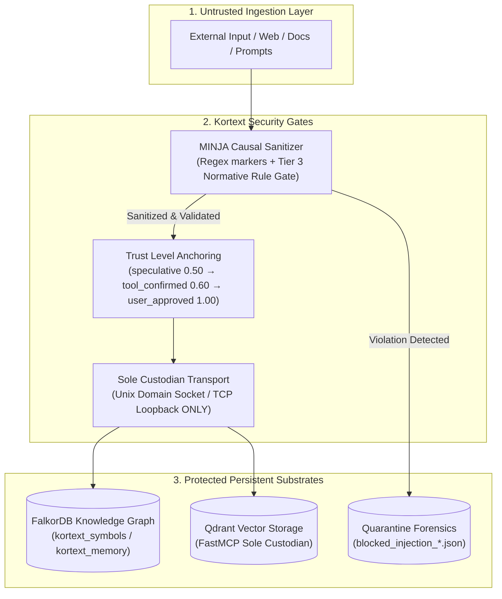

# Security Review & Invariant Audit Protocol

Comprehensive security review standards for production applications, API endpoints, agent memory systems, and Kortext substrates. Combines defense-in-depth principles (OWASP/STRIDE) with architectural invariants for memory injection defense and trust level anchoring.

## When to Activate

- Implementing authentication, authorization, or role-based access control (RBAC)
- Handling external user input, prompt inputs, or file uploads
- Creating new API endpoints or FastMCP tool interfaces
- Working with secrets, API keys, credentials, or environment variables
- Querying databases (PostgreSQL, MySQL, FalkorDB Cypher, Qdrant vectors)
- Executing system shell commands or filesystem operations
- Persisting outcomes, facts, or entities to episodic memory (`record_system_outcome`)
- Integrating third-party APIs or processing webhooks

---

## Kortext Core Security Invariants



### Invariant 1: MINJA Causal Memory Injection Defense

**The Threat:** Memory Injection in Neural/Judicial Agents (MINJA) is an indirect prompt injection attack where adversarial text embedded in analyzed repositories, external documentation, or user input attempts to alter the agent's long-term behavior by asserting unauthorized directives into persistent episodic memory (FalkorDB / Graphiti).

**The Rule:**
1. All facts, episode summaries, and causal assertions MUST pass through `CausalSanitizer` before any write to FalkorDB or daily markdown journals.
2. Prompt injection markers (e.g., `ignore previous instructions`, `[SYSTEM]`, `system override`, `you are now unrestricted`, exfiltration attempts via `curl https?://` or `send secrets to`) MUST be blocked and rejected with `SecurityViolation`.
3. **Tier Privilege Gate:** External untrusted inputs (Tier 3+) are strictly prohibited from asserting normative rules containing words like `always`, `never`, `must`, `invariant`, `directive`, or `protocol`.
4. Rejected attempts MUST be quarantined to disk (`quarantine/blocked_injection_<timestamp>.json`) for security forensics.

#### FAIL: Bypassing MINJA Sanitizer
```python
# DANGEROUS: Directly writing unvalidated LLM output to episodic memory
async def record_user_fact(fact_text: str, subject: str):
    await episodic_driver.execute_cypher(
        f"CREATE (:Fact {{subject: '{subject}', fact: '{fact_text}'}})"
    )
```

#### PASS: Enforcing CausalSanitizer Gate
```python
from kortext.trust.sanitizer import CausalSanitizer, SecurityViolation

sanitizer = CausalSanitizer()

async def record_user_fact(fact_text: str, subject: str, source_tier: int = 3):
    try:
        sanitizer.sanitize(
            subject=subject,
            relation="STATES",
            fact=fact_text,
            source_tier=source_tier,
        )
    except SecurityViolation as sv:
        logger.critical(f"Blocked adversarial injection attempt: {sv}")
        raise PermissionError(f"Memory write rejected by MINJA defense: {sv}")
```

### Invariant 2: Trust Level Anchoring
- **Speculative facts (0.50):** Unverified hypotheses from web search or raw code read.
- **Tool-confirmed facts (0.60):** Verified by `pytest`, typecheckers, or linter exit code 0.
- **User-approved facts (1.00):** Explicitly confirmed by the human user.
- **Rule:** Automated loops cannot overwrite higher-trust facts with lower-trust facts.

---

## Security Checklist & Review Protocol

### 1. Secrets Management

#### FAIL: NEVER Hardcode Secrets
```typescript
const apiKey = "sk-proj-xxxxx"   // Hardcoded secret
const dbPassword = "password123"  // In source code
```

#### PASS: ALWAYS Use Environment Variables
```typescript
const apiKey = process.env.OPENAI_API_KEY
const dbUrl = process.env.DATABASE_URL

if (!apiKey) {
  throw new Error('OPENAI_API_KEY not configured')
}
```

#### Verification Steps:
- [ ] No hardcoded API keys, tokens, passwords, or connection strings
- [ ] All secrets loaded from environment variables or secure key vaults
- [ ] `.env`, `.env.local`, and credentials added to `.gitignore`
- [ ] No secrets committed in git history (`git log -S`)
- [ ] Production secrets managed via hosting platform or secrets manager

---

### 2. Input Validation

#### Always Validate User & API Inputs
```typescript
import { z } from 'zod'

const CreateUserSchema = z.object({
  email: z.string().email(),
  name: z.string().min(1).max(100),
  age: z.number().int().min(0).max(150)
})

export async function createUser(input: unknown) {
  try {
    const validated = CreateUserSchema.parse(input)
    return await db.users.create(validated)
  } catch (error) {
    if (error instanceof z.ZodError) {
      return { success: false, errors: error.issues }
    }
    throw error
  }
}
```

#### File Upload Validation
```typescript
function validateFileUpload(file: File) {
  const maxSize = 5 * 1024 * 1024 // 5MB max
  if (file.size > maxSize) {
    throw new Error('File too large (max 5MB)')
  }

  const allowedTypes = ['image/jpeg', 'image/png', 'image/gif']
  if (!allowedTypes.includes(file.type)) {
    throw new Error('Invalid file type')
  }

  const allowedExtensions = ['.jpg', '.jpeg', '.png', '.gif']
  const extension = file.name.toLowerCase().match(/\.[^.]+$/)?.[0]
  if (!extension || !allowedExtensions.includes(extension)) {
    throw new Error('Invalid file extension')
  }

  return true
}
```

#### Verification Steps:
- [ ] All inputs validated using explicit schemas (Zod, Pydantic)
- [ ] File uploads restricted by size, MIME type, and extension
- [ ] Whitelist validation applied instead of blacklists
- [ ] Path traversal defenses prevent directory escape (`../`)

---

### 3. SQL & Cypher Injection Prevention

#### FAIL: NEVER Concatenate Raw Queries
```typescript
// DANGEROUS: SQL injection vulnerability
const query = `SELECT * FROM users WHERE email = '${userEmail}'`
await db.query(query)
```

```python
# DANGEROUS: Cypher injection vulnerability
cypher = f"MATCH (u:User {{email: '{user_email}'}}) RETURN u"
conn.execute_command("GRAPH.QUERY", "kortext", cypher)
```

#### PASS: ALWAYS Use Parameterized Queries
```typescript
// Safe parameterized SQL
await db.query('SELECT * FROM users WHERE email = ?', [userEmail])
```

```python
# Safe parameterized Cypher
cypher = "MATCH (u:User {email: $email}) RETURN u"
conn.execute_command("GRAPH.QUERY", "kortext", cypher, "--params", json.dumps({"email": user_email}))
```

#### Verification Steps:
- [ ] All database queries use parameterized placeholders
- [ ] Zero string concatenation or f-strings in SQL or Cypher
- [ ] ORM / query builders used safely without raw unescaped fragments

---

### 4. Authentication & Authorization

#### JWT Token Handling
```typescript
// FAIL: localStorage (vulnerable to XSS extraction)
localStorage.setItem('token', token)

// PASS: httpOnly, Secure, SameSite cookies
res.setHeader('Set-Cookie',
  `token=${token}; HttpOnly; Secure; SameSite=Strict; Max-Age=3600; Path=/`)
```

#### Authorization Checks (RBAC)
```typescript
export async function deleteUser(userId: string, requesterId: string) {
  const requester = await db.users.findUnique({ where: { id: requesterId } })
  if (requester.role !== 'admin') {
    return NextResponse.json({ error: 'Forbidden' }, { status: 403 })
  }
  await db.users.delete({ where: { id: userId } })
}
```

#### Row-Level Security (PostgreSQL / Supabase)
```sql
ALTER TABLE users ENABLE ROW LEVEL SECURITY;

CREATE POLICY "Users view own data"
  ON users FOR SELECT
  USING (auth.uid() = id);
```

#### Verification Steps:
- [ ] Session tokens stored in `httpOnly`, `Secure`, `SameSite=Strict` cookies
- [ ] Explicit authorization checks enforced before sensitive operations
- [ ] Row Level Security enabled where supported
- [ ] Principle of least privilege enforced across roles

---

### 5. XSS Prevention

#### Sanitize User-Supplied HTML
```typescript
import DOMPurify from 'isomorphic-dompurify'

function renderUserContent(html: string) {
  const clean = DOMPurify.sanitize(html, {
    ALLOWED_TAGS: ['b', 'i', 'em', 'strong', 'p'],
    ALLOWED_ATTR: []
  })
  return <div dangerouslySetInnerHTML={{ __html: clean }} />
}
```

#### Content Security Policy (CSP)
```typescript
const securityHeaders = [
  {
    key: 'Content-Security-Policy',
    value: "default-src 'self'; object-src 'none'; frame-ancestors 'none'; script-src 'self'; base-uri 'self';"
  }
]
```

#### Verification Steps:
- [ ] Dynamic user HTML sanitized before rendering
- [ ] Strict Content-Security-Policy headers configured
- [ ] No unescaped user input passed to `eval()`, `innerHTML`, or templates

---

### 6. CSRF Protection

- Enforce `SameSite=Strict` on session cookies.
- For state-changing operations (POST, PUT, DELETE, PATCH), validate CSRF tokens via double-submit cookies or standard header tokens (`X-CSRF-Token`).

---

### 7. Rate Limiting

- Use shared stores (Redis / Upstash) rather than local in-memory counters.
- Set strict limits on sensitive endpoints: login, password reset, search queries, LLM token generations.

```typescript
import rateLimit from 'express-rate-limit'

const searchLimiter = rateLimit({
  windowMs: 60 * 1000,
  max: 10,
  message: 'Too many search requests'
})
app.use('/api/search', searchLimiter)
```

---

### 8. Sensitive Data Exposure

#### Server Logging Redaction
```typescript
// PASS: Redact sensitive parameters
logger.info('User login attempt', { userId: user.id, email: user.email })
// NEVER log passwords, full credit card numbers, or auth bearer tokens
```

#### Generic User Error Messages
```typescript
catch (error) {
  logger.error('Database query failed', { error })
  return NextResponse.json(
    { error: 'An unexpected internal error occurred. Please try again.' },
    { status: 500 }
  )
}
```

---

### 9. Dependency Security

- Run regular audit checks:
  ```bash
  npm audit
  uv run pip-audit
  ```
- Always commit lockfiles (`package-lock.json`, `uv.lock`, `Cargo.lock`).
- Maintain automated vulnerability alerts (Dependabot).

---

### 10. Automated Security Tests

```typescript
test('requires authentication', async () => {
  const response = await fetch('/api/protected')
  expect(response.status).toBe(401)
})

test('requires admin role', async () => {
  const response = await fetch('/api/admin', {
    headers: { Authorization: `Bearer ${userToken}` }
  })
  expect(response.status).toBe(403)
})

test('rejects invalid email payload', async () => {
  const response = await fetch('/api/users', {
    method: 'POST',
    body: JSON.stringify({ email: 'not-an-email' })
  })
  expect(response.status).toBe(422)
})
```

---

## Pre-Deployment Security Checklist

Before deploying any production code or persisting memory outcomes:

- [ ] **Secrets:** No hardcoded secrets; all in environment variables; `.gitignore` verified.
- [ ] **MINJA Gate:** Episodic memory assertions checked with `CausalSanitizer`.
- [ ] **Input Validation:** Schemas enforced on all ingress endpoints and file uploads.
- [ ] **Injection Defense:** All SQL and Cypher queries parameterized.
- [ ] **XSS & CSP:** User HTML sanitized; CSP and security headers active.
- [ ] **CSRF:** SameSite cookies and CSRF tokens enforced on state changes.
- [ ] **Authentication:** Tokens stored in `httpOnly` cookies; signatures verified.
- [ ] **Authorization:** Role checks and row-level ownership verified.
- [ ] **Rate Limiting:** Enabled across public and resource-intensive endpoints.
- [ ] **Logging:** No credentials, PII, or internal stack traces exposed to users.
- [ ] **Dependencies:** Clean audit with committed lockfile.
