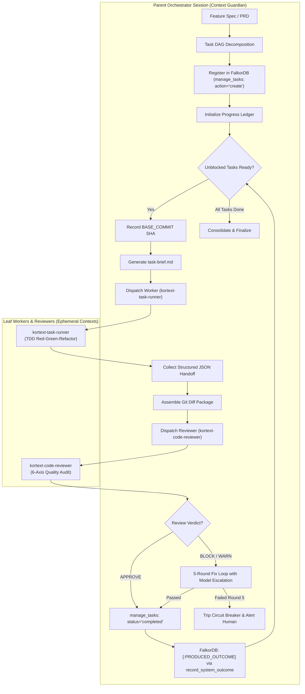
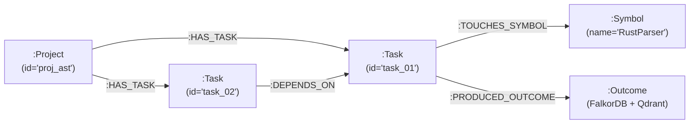

# Subagent-Driven Development (SDD) Protocol

An enterprise multi-agent execution framework combining Obra and Jose Parreño Garcia multi-agent patterns with Kortext's graph-backed Task DAG, isolated execution workers, automated code review gates, and causal episodic memory linking.

---

## Operating Principles: The Orchestrator-Worker Architecture

SDD splits software engineering into distinct, specialized agent roles to prevent context pollution, eliminate hallucination loops, and enforce deterministic quality gates:



### Core Architecture Rules

1. **Context Protection Invariant:** The orchestrator never edits production files, executes multi-page test suites inline, or engages in raw debugging. It coordinates, delegates, and audits.
2. **Ephemeral Leaf Isolation:** Workers execute in fresh, isolated context windows bounded by a single atomic task brief (`task-brief.md`).
3. **Deterministic Review Gate:** No worker's changes merge into the active branch without independent audit and approval by `kortext-code-reviewer`.
4. **Episodic Outcome Persistence:** Every completed DAG node is permanently anchored to Kortext graph and vector memory (`:Task`-[:PRODUCED_OUTCOME]->`:Outcome`).

---

## Task DAG State Machine via `manage_tasks`

All tasks, dependencies, and execution lifecycles are durably persisted in FalkorDB via the `manage_tasks` tool.

```
[ pending ] ──(dependencies satisfied)──> [ ready ] ──(worker dispatched)──> [ in_progress ]
                                                                                   │
                                            ┌──────────────────────────────────────┴────────┐
                                            ▼                                               ▼
                                      [ completed ]                                     [ failed ]
                                            │                                               │
                               (unlocks dependent nodes)                             (blocks dependents)
```

### 1. Registering Tasks in the DAG

```python
# Create root task
manage_tasks(
    action="create",
    task_id="task_ast_parser_01",
    title="Implement Rust Tree-sitter Parser Binding",
    description="Add Tree-sitter query bindings for extracting Rust struct declarations and impl blocks.",
    dependencies=[],
    complexity=3,
    assigned_to="kortext-task-runner"
)

# Create dependent task
manage_tasks(
    action="create",
    task_id="task_ast_store_02",
    title="Persist Rust AST Nodes in FalkorDB",
    description="Implement Cypher node writer for Rust AST symbols with bitemporal timestamps.",
    dependencies=["task_ast_parser_01"],
    complexity=2,
    assigned_to="kortext-task-runner"
)
```

### 2. The 15-Minute Atomic Task Unit Rule

Every task registered in the DAG must satisfy three criteria to prevent worker drift:

1. **Single Dominant Risk:** Focuses on exactly one architectural concern (e.g., Schema model, IPC socket client, or Service logic).
2. **Explicit Target Boundary:** Explicitly identifies files and symbols to touch (`seek_symbol`).
3. **Executable Done Condition:** Contains a deterministic command (e.g., `uv run pytest tests/test_rust_parser.py`) asserting 100% pass rate.

---

## Isolated Task Brief Generation (`task-brief.md`) & Base Commit Anchoring

Before dispatching `kortext-task-runner`, the orchestrator records the current Git state and writes a self-contained execution contract.

### 1. Anchor Base Commit

```bash
BASE_COMMIT=$(git rev-parse HEAD)
```
*Rationale:* Recording the exact base commit SHA ensures the subsequent code review diff package isolates only the changes authored during this specific task turn.

### 2. Task Brief Schema (`task-brief.md`)

```markdown
# Task Brief: task_ast_parser_01

## Metadata
- **Task ID:** task_ast_parser_01
- **Base Commit:** a1b2c3d4e5f67890123456789abcdef012345678
- **Assigned Worker:** kortext-task-runner
- **Model Tier:** Balanced (Flash/Sonnet)

## Objective
Implement Tree-sitter Rust AST query bindings to locate struct definitions and method signatures.

## Target Symbols & Files
- Target file: `src/kortext/ast/parsers/rust.py`
- Test file: `tests/unit/test_rust_parser.py`
- Reference symbols (inspect via seek_symbol):
  - `seek_symbol(symbol_name="BaseAstParser")`
  - `seek_symbol(symbol_name="AstNodeRecord")`

## Invariants & Constraints
- Immutability: AstNodeRecord must be a frozen dataclass.
- Error handling: Raise UnsupportedGrammarError on syntax errors; never swallow exceptions.
- Anti-Ripgrep Mandate: Do not use regex or ripgrep for symbol location.

## Done Condition & Verification
Run the targeted test suite:
`uv run pytest tests/unit/test_rust_parser.py -q`
Verification criteria: 100% passing tests with >=80% branch coverage.
```

---

## Code Review Dispatch (`kortext-code-reviewer`) on Diff Package

When the leaf worker completes its implementation and reports 100% test passes, the orchestrator packages the diff and dispatches `kortext-code-reviewer`.

### 1. Assembling the Diff Package

```bash
# Capture full unified diff against the recorded base commit
git diff $BASE_COMMIT...HEAD
```

### 2. Dispatching the Reviewer

The orchestrator invokes `kortext-code-reviewer` with:
- The original `task-brief.md`.
- The unified `git diff`.
- The worker's test execution summary and logs.

### 3. The 6-Axis Review Audit

`kortext-code-reviewer` audits the diff against six rigorous axes:

1. **Specification Compliance:** Does the diff satisfy all acceptance criteria in the task brief?
2. **Cognitive Complexity & Structure:** Are functions <50 lines? Files <400 lines? Nesting <=3 levels?
3. **Kortext Invariants:** Are socket IPC patterns followed? AST symbol lookups used instead of ripgrep? FastMCP Sole Custodian respected?
4. **Test Coverage & TDD Evidence:** Minimum 80% coverage? Boundary conditions and error paths tested?
5. **Security Hygiene:** Zero hardcoded secrets? Inputs validated at boundaries? No Cypher/SQL injection?
6. **Blast Radius Analysis:** Did the author run `trace_symbol_impact` on modified public symbols?

### 4. Review Verdicts

- **`APPROVE`:** Diff meets all criteria. Unlocks task completion.
- **`WARN`:** Non-blocking minor polish (e.g., naming improvement, docstring formatting). Worker may proceed.
- **`BLOCK`:** Critical flaw, invariant breach, or missing tests. Initiates the Fix Loop.

---

## The 5-Round Fix Loop with Model Escalation

When `kortext-code-reviewer` issues a `BLOCK` or significant `WARN`, SDD enters a structured fix loop with progressive model escalation:

| Round | Assigned Agent & Model Tier | Scope & Strategy | Escalation Trigger |
|---|---|---|---|
| **Round 1** | `kortext-task-runner`<br>*(Fast / Balanced Tier)* | Worker addresses specific reviewer findings using TDD. | Reviewer re-evaluates diff.<br>If still `BLOCK` ➔ Round 2. |
| **Round 2** | `kortext-task-runner`<br>*(Fast / Balanced Tier)* | Worker addresses secondary edge cases, test gaps, or typing errors. | Reviewer re-evaluates diff.<br>If still `BLOCK` ➔ Round 3. |
| **Round 3** | `kortext-task-runner`<br>*(Fast / Balanced Tier)* | Final attempt on baseline model tier with tightened instructions. | Reviewer re-evaluates diff.<br>If still `BLOCK` ➔ **Escalate to Pro**. |
| **Round 4** | `kortext-task-runner`<br>*(High-Reasoning `pro` Tier)* | **Model Escalation:** High-reasoning model ingests full diff history, reviewer critique, and substrate invariants. Resolves subtle architectural mismatches. | Reviewer re-evaluates diff.<br>If still `BLOCK` ➔ Round 5. |
| **Round 5** | `kortext-task-runner`<br>*(High-Reasoning `pro` Tier)* | Final resolution attempt on high-reasoning model tier. | If still `BLOCK` ➔ **TRIP CIRCUIT BREAKER**. |

### Round 5 Circuit Breaker

If the fix loop reaches Round 5 without achieving `APPROVE`:

1. **HALT EXECUTION:** Terminate autonomous retry loops immediately.
2. **Freeze & Revert:** Revert the branch back to `$BASE_COMMIT` to prevent polluting the codebase with unstable code.
3. **Mark Task Failed:** Update DAG state: `manage_tasks(action="update", task_id="...", status="failed")`.
4. **Generate Escalation Report:** Document all 5 rounds, reviewer feedback, and root cause hypotheses in the progress ledger.
5. **Alert Human Partner:** Present clear findings and request architectural review.

---

## Progress Ledger & Structured Handoff Contract

### 1. Living Progress Ledger

The orchestrator maintains a progress ledger throughout the initiative:

```markdown
# SDD Progress Ledger: Initiative-TreeSitter-Ingestion

| Task ID | Title | Status | Worker | Rounds | Tests | Review Verdict |
|---|---|---|---|---|---|---|
| `task_01` | Tree-sitter Rust Query Bindings | `completed` | `task-runner` | 1 | 14/14 Pass | `APPROVE` |
| `task_02` | FalkorDB Rust Node Persistence | `completed` | `task-runner` | 2 | 22/22 Pass | `APPROVE` |
| `task_03` | FastMCP AST Tool Ingestion Route | `in_progress`| `task-runner` | 1 | Pending | Pending |
```

### 2. Structured Worker Handoff Contract

Every worker subagent MUST conclude by calling `send_message` to the parent orchestrator with a standardized JSON payload:

```json
{
  "task_id": "task_ast_parser_01",
  "status": "completed",
  "modified_files": [
    "/Users/rb/kortext/src/kortext/ast/parsers/rust.py",
    "/Users/rb/kortext/tests/unit/test_rust_parser.py"
  ],
  "tests_passed": true,
  "test_summary": "14 passed, 0 failed in 1.42s (88% coverage)",
  "evidence": "Implemented Tree-sitter Rust bindings. Verified struct and impl queries against sample Rust AST fixtures with 100% test pass rate."
}
```

---

## Delegation Completion Contract

To ensure predictable execution and zero lost context:

1. **Primary Context Ownership:** The parent orchestrator owns task collection and consolidation. No leaf worker may perform global orchestration or invoke other workers recursively unless explicitly delegated as a sub-orchestrator.
2. **Zero Orphaned Turns:** A task is never considered finished until the parent receives and validates the structured JSON handoff. Background tasks must terminate cleanly or be explicitly managed.
3. **Branch & Commit Cleanliness:**
   - Tasks execute on dedicated task branches or clean working tree checkpoints.
   - Merging occurs only after both test suite pass (100%) and reviewer `APPROVE`.

---

## Kortext Superpower: Graph-Backed Task DAG & FalkorDB Outcome Linking

Kortext bridges project orchestration and semantic memory by linking the execution graph directly into the FalkorDB knowledge graph and Qdrant vector memory.



### 1. Linking Completed Tasks to Episodic Memory

When a task achieves `completed` status, the orchestrator persists the achievement using `record_system_outcome`:

```python
record_system_outcome(
    title="Completed task_ast_parser_01: Tree-sitter Rust Bindings",
    narrative="Added Tree-sitter query bindings for extracting Rust struct declarations and impl blocks. Validated AST queries across 14 unit test fixtures.",
    evidence="14 passed in 1.42s, 88% coverage. Zero regressions.",
    tags=["ast", "tree-sitter", "rust", "task-dag"]
)
```

### 2. FalkorDB Cypher Edge Creation

Kortext automatically generates the graph relationship:
```cypher
MATCH (t:Task {id: $task_id}), (o:Outcome {title: $outcome_title})
CREATE (t)-[:PRODUCED_OUTCOME]->(o)
```

### 3. Causal Historical Retrieval

When future agents execute similar tasks, they invoke `search_knowledge_and_memory`:
```python
search_knowledge_and_memory(query="tree-sitter query parser implementation")
```
This returns the exact design decisions, pitfalls, and code solutions recorded in prior SDD cycles, providing immediate contextual recall without exploratory token waste.
