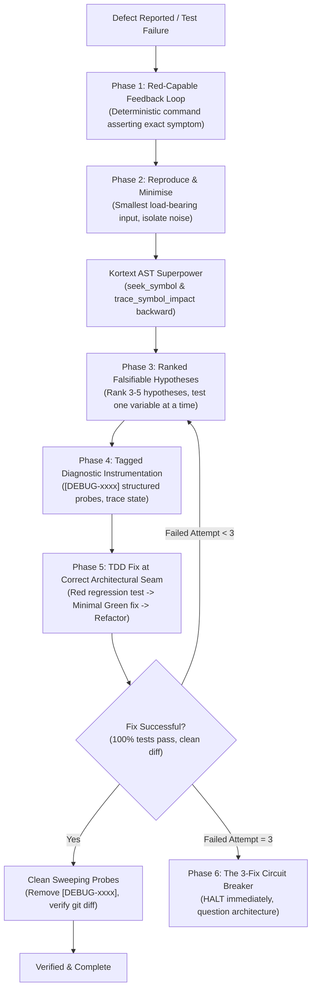
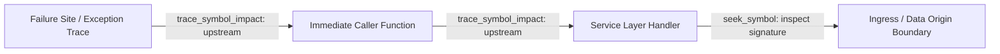
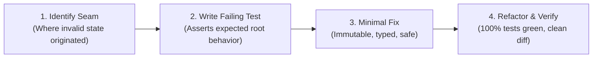

# Systematic Debugging Protocol

A disciplined, root-cause-first debugging methodology engineered to eliminate speculative guesswork, stop defect regressions, and resolve software bugs at their foundational architectural seam.

---

## The Iron Law

> **NO FIXES WITHOUT ROOT CAUSE INVESTIGATION FIRST.**
> Symptom fixes are failure. If you haven't identified the root cause, you cannot propose or implement fixes.

Never apply speculative patches, blind workarounds, or defensive `try/except` wrappers around symptoms. Every defect is caused by an unbroken causal chain originating from an invalid assumption, violated invariant, or corrupted state transition. Your objective is to trace that chain back to its origin before proposing any code change.

### Prohibited Debugging Anti-Patterns

- **Speculative Patching:** Modifying code based on "this might fix it" without a proven causal explanation.
- **Defensive Swallowing:** Wrapping the failure site in `try...except Exception: pass` or default fallbacks that silence errors.
- **Shotgun Debugging:** Changing multiple files or parameters simultaneously hoping the test turns green.
- **Symptom Masking:** Patching an assertion in a test instead of addressing the production defect.

---

## Debugging Lifecycle Overview



---

## Phase 1: Construct a Red-Capable Feedback Loop

Before inspecting source code or forming hypotheses, build a deterministic, automated feedback loop.

### 1. Requirements for the Feedback Loop

- **Deterministic Reproduction:** The command must fail 100% of the time with the exact reported defect. A test that fails intermittently is not ready for Phase 2 until non-determinism is eliminated.
- **Fast Execution (<5 seconds):** Debugging requires rapid cycle iteration. Target a focused test target or minimal script:
  ```bash
  # Python / pytest
  uv run pytest tests/unit/test_session.py -k test_session_expiry_edge_case -q

  # TypeScript / Node
  pnpm test tests/auth/session.spec.ts -t "expires session after timeout"

  # Curl / HTTP API
  curl -s -X POST http://localhost:8000/api/v1/sessions -d '{"invalid": true}' | jq .
  ```
- **Exact Symptom Assertion:** The feedback command must assert the failure signature (exception class, error code, HTTP status, or mismatched payload), not an incidental failure or timeout.

### 2. Rule: Zero Hypotheses Without a Red Command

Do not jump to conclusions, guess solutions, or edit source code without an executable red command. Speculation without reproduction wastes tokens, introduces regressions, and creates cognitive bias.

---

## Kortext Superpower: AST Symbol Navigation (<100ms)

When tracing a defect from the failure site backward to the root data origin, **NEVER use `ripgrep`, `grep`, or brute-force regex scanning**.



### Why AST B-Tree Navigation Beats Brute-Force Grep

| Dimension | ❌ Brute-Force Grep (`rg`) | ✅ Kortext AST (`seek_symbol` / `trace_symbol_impact`) |
|---|---|---|
| **Latency** | 200ms - 2,500ms across large repos | **<2ms** direct B-Tree point lookup |
| **Token Cost** | 8,000 - 16,000 noisy tokens | **~120 tokens** per symbol node |
| **Precision** | High false positives (comments, mocks) | **100% deterministic** AST declaration matching |
| **Call Graphs** | Blind string hits requiring manual inspection | **Structured upstream & downstream traversal** |

### Execution Protocol

1. **Locate Declaration & Signatures:**
   ```python
   seek_symbol(symbol_name="process_token_payload")
   ```
   *Returns:* File path, line ranges, full type annotations, docstring, callers, and callees.

2. **Trace Upstream Blast Radius & Call Hierarchy:**
   ```python
   trace_symbol_impact(symbol="process_token_payload", direction="upstream")
   ```
   *Returns:* Exact graph path of callers feeding arguments into the failing function.

3. **Inspect File Context Surgically:**
   Use `view_file` targeted to the exact line range identified by `seek_symbol` rather than reading entire files.

---

## Phase 2: Reproduce & Minimise

Once a deterministic red command exists, shrink the reproduction scenario to the smallest load-bearing input.

### Minimisation Protocol

1. **Prune Incidental Fields:** Remove every payload attribute, mock header, or query parameter that is not strictly necessary to trigger the failure.
2. **Isolate State Dependencies:** Replace external database states or network mocks with minimal in-memory structures.
3. **Verify Load-Bearing Integrity:**
   - Remove parameter $A$: does it still fail with the exact same error? If yes, parameter $A$ is incidental—discard it.
   - Remove parameter $B$: does the error disappear or change signature? Parameter $B$ is load-bearing—retain it.
4. **Confirm Failure Signature Fidelity:** Ensure the error message, exception type, and stack trace exactly match the original user or system report.

---

## Phase 3: Formulate Ranked, Falsifiable Hypotheses

Do not start testing ideas randomly. Brainstorm and document **3 to 5 ranked hypotheses** before writing any code.

### Hypothesis Construction Rules

Every hypothesis must satisfy the falsifiability template:

> **"If [Root Cause X] is true, then [Minimal Modification Y] will produce [Observable Outcome Z]."**

```
Rank 1: Plausibility High, Verification Effort Low
Rank 2: Plausibility High, Verification Effort Medium
Rank 3: Plausibility Medium, Verification Effort Low
Rank 4: Plausibility Medium, Verification Effort High
Rank 5: Plausibility Low (Edge case / Substrate invariant breach)
```

### The Single-Variable Rule

- **Test exactly one variable at a time.**
- If a modification fails to confirm the hypothesis, **revert the change immediately** before testing the next hypothesis.
- Never layer speculative changes on top of each other. Compounding unverified edits creates phantom interactions and obscures the true defect.

---

## Phase 4: Diagnostic Instrumentation with Tagged Probes

When static inspection and call hierarchy tracing do not reveal the exact invalid state, inject surgical diagnostic probes.

### The Tagged Probe Convention (`[DEBUG-xxxx]`)

Tag all diagnostic logging statements with a unique 4-character hex or alphanumeric identifier:

```python
# Arrange surgical probe in Python
logger.info("[DEBUG-9a1f] Ingress payload before normalization: %s, type=%s", payload, type(payload))
logger.info("[DEBUG-9a1f] Invariant check evaluated: %s (threshold=%s)", is_valid, THRESHOLD)
```

```typescript
// Arrange surgical probe in TypeScript
console.log(`[DEBUG-e4c2] Substrate response status: ${response.status}, keys=${Object.keys(response.data)}`);
```

### Rules for Diagnostic Probes

1. **Unique Tag per Investigation:** Use the same tag (e.g., `[DEBUG-9a1f]`) for all probes in the current session.
2. **Log State & Types, Not Just Messages:** Always log the actual values, data types, and branch conditions, not generic "reached here" strings.
3. **Atomic Clean Sweep:** When the root cause is confirmed, remove all probes in a single sweep:
   ```bash
   git diff | grep DEBUG
   ```
   No commit may contain debug probe statements.

---

## Phase 5: TDD Fix at the Correct Architectural Seam

Once the root cause is proven through reproduction and falsifiable testing, implement the resolution using strict Test-Driven Development (TDD).



### 1. Identify the Correct Architectural Seam

- **Wrong Seam:** Patching the view or UI handler to convert `None` to empty string because the database returned `None`.
- **Correct Seam:** Fixing the repository or domain model parser that unexpectedly produced `None` instead of the expected entity.

### 2. Red: Author the Failing Regression Test

- Write a dedicated regression test asserting the correct behavior at the identified seam.
- Run the test suite: verify it fails with the expected root cause signature.

### 3. Green: Minimal, Robust Implementation

- Write only the code required to satisfy the regression test.
- Follow core project coding standards:
  - **Immutability:** Return new objects; never mutate input parameters.
  - **Explicit Error Handling:** Raise typed domain exceptions; never swallow errors.
  - **Strict Typing:** Annotate all arguments and return types.
  - **KISS & YAGNI:** Avoid speculative abstractions.

### 4. Refactor & Verification

- Clean up temporary probes and formatting.
- Execute full test suite to guarantee zero regressions:
  ```bash
  uv run pytest -q
  ```

---

## Phase 6: The 3-Fix Circuit Breaker

The 3-Fix Circuit Breaker is an immutable safety mechanism preventing destructive thrashing, hallucination cascades, and architectural decay.

```
Attempt 1 Fails ──> Rollback ──> Attempt 2 Fails ──> Rollback ──> Attempt 3 Fails ──> 🛑 CIRCUIT BREAKER TRIPS!
```

### The Circuit Breaker Protocol

If **3 consecutive fix attempts fail** to resolve the defect:

1. **STOP IMMEDIATELY:** Cease all code editing and test patching.
2. **Acknowledge the Signal:** 3 consecutive failures is **not** bad luck. It is definitive mathematical proof that:
   - The current mental model of the system is flawed.
   - The root cause has not been identified.
   - The proposed fixes are addressing symptoms at the wrong architectural layer.
3. **Rollback Speculative Changes:** Revert all uncommitted modifications back to the clean baseline:
   ```bash
   git checkout .
   git clean -fd
   ```
4. **Question Foundational Assumptions:**
   - Are the substrate socket connections operating as assumed?
   - Is an external dependency or cache layer behaving unexpectedly?
   - Has an invariant been broken further upstream?
5. **Report to Orchestrator / Human:** Document the 3 falsified hypotheses, the observed failure modes, and open an architectural review before proceeding.

---

## Rationalization Defense Matrix

AI agents and software engineers frequently invent rationalizations to bypass systematic debugging. Recognize and reject these traps:

| Rationalization | Underlying Fallacy | Mandated Protocol Action |
|---|---|---|
| *"This is just a quick edge case, I don't need a test."* | Unverified assumptions always produce regressions. | **REJECT.** Create a deterministic red command before touching code. |
| *"I'll just add `try/except Exception: pass` here to keep it from crashing."* | Error silencing violates observability and leaves corrupted state. | **REJECT.** Trace invalid state upstream to its origin. |
| *"Let me try one more tweak before checking the root cause."* | Sunk cost fallacy and cognitive drift. | **REJECT.** If you don't know the root cause, you cannot write a fix. |
| *"Let's change these three configs together to see if it starts."* | Multi-variable confusion renders outcomes uninterpretable. | **REJECT.** Change exactly one variable at a time. |
| *"The 3 attempts were close, attempt 4 will definitely work."* | Denial of circuit breaker breach. | **HALT.** The 3-Fix Circuit Breaker is absolute. Stop and question architecture. |

---

## Verification Checklist

Before declaring a debugging task complete:

- [ ] Red feedback loop established and proven before code modifications.
- [ ] Root cause identified via AST navigation (`seek_symbol`, `trace_symbol_impact`).
- [ ] Minimal reproduction scenario isolated to load-bearing inputs.
- [ ] 3-5 ranked, falsifiable hypotheses generated and evaluated systematically.
- [ ] Diagnostic probes tagged (`[DEBUG-xxxx]`) and cleanly removed before commit.
- [ ] Regression test authored at the correct architectural seam.
- [ ] Minimal, immutable, and strictly typed fix implemented.
- [ ] Full test suite passes 100% (`uv run pytest -q`).
- [ ] Circuit breaker strictly respected if 3 attempts failed.
