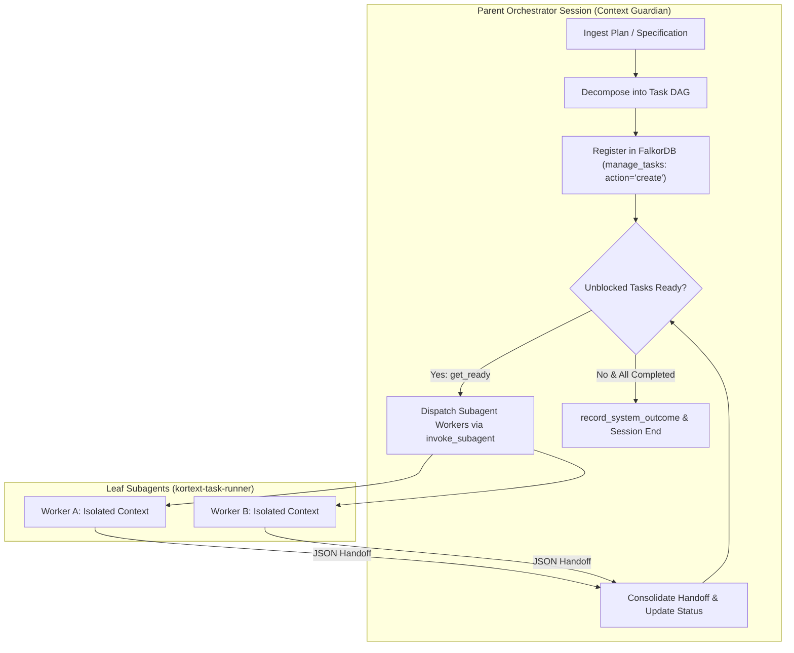
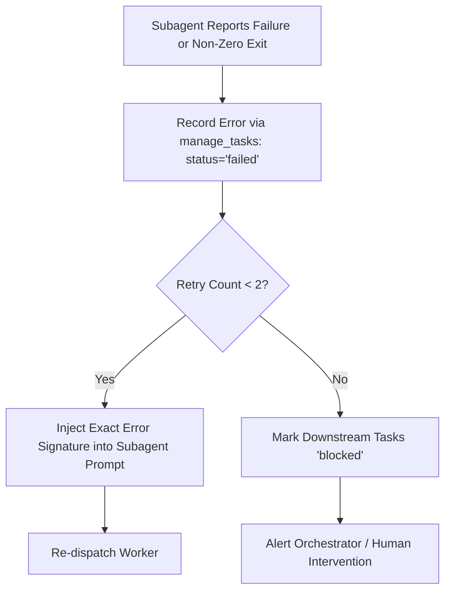

# Kortext Task DAG Orchestration Protocol

This skill governs multi-step project management, graph-backed Task DAG execution, and subagent swarm orchestration across Kortext. Modeled on ECC's `plan-orchestrate` and `orch-pipeline`, it guarantees parent context preservation, atomic task execution, and automated dependency resolution via FalkorDB.

---

## Operating Principles: The Orchestrator-Worker Model



1. **Context Protection Invariant:** The orchestrator never performs raw code edits, runs extensive debug loops, or ingests multi-page test logs inline.
2. **Deterministic DAG Backing:** All tasks, dependencies, and state transitions are stored durably in the FalkorDB knowledge graph via `manage_tasks`.
3. **The 15-Minute Atomic Unit Rule:** Every task must be bounded, isolated, and executable by a single leaf worker in under 15 minutes.
4. **Structured Verification Gate:** No task moves to `completed` without verified 100% test pass evidence and AST invariant validation.

---

## The 15-Minute Atomic Task Unit Rule

To avoid context explosion and unrecoverable subagent drift, decompose large initiatives into atomic DAG nodes meeting three strict criteria:

### Criteria for Atomic Units
1. **Single Dominant Risk:** A task handles one specific concern (e.g., Schema model, Repository layer, Service logic, or Test suite).
2. **Explicit Ingress / Egress:** Known files to modify, explicit symbols to touch (`seek_symbol`), and no open-ended exploratory tasks.
3. **Executable Done Condition:** A deterministic command (e.g., `pytest tests/test_session.py`, `bun test`) with 100% pass rate.

### Example Task DAG Decomposition
```
Plan: Implement Bi-Temporal Invalidation in Kortext Memory
├── T1: Define BiTemporalInterval Schema & Constraints (Pydantic models)
├── T2: Implement FalkorDB Invalidation Cypher Mutation (depends_on: [T1])
├── T3: Implement FastMCP Tool Adapter delete_or_supersede_fact (depends_on: [T2])
└── T4: Integration Test Invalidation & Pruning Lifecycle (depends_on: [T3])
```

---

## Graph-Backed Task State Machine via `manage_tasks`

Tasks transition through validated graph states:

```
[ pending ] ──(dependencies satisfied)──> [ ready ] ──(worker dispatched)──> [ in_progress ]
                                                                                   │
                                            ┌──────────────────────────────────────┴────────┐
                                            ▼                                               ▼
                                      [ completed ]                                     [ failed ]
                                            │                                               │
                               (unlocks dependent nodes)                             (blocks dependents / retries)
```

### 1. Registering Tasks (`action="create"`)
```python
# Task 1: Schema (Root task)
manage_tasks(
    action="create",
    task_id="task_schema_bitemp",
    title="Implement BiTemporalInterval Pydantic Model",
    description="Create BiTemporalInterval schema with valid_from and valid_until validation.",
    dependencies=[],
    complexity=2,
    assigned_to="kortext-task-runner"
)

# Task 2: Repository Mutation (Depends on Task 1)
manage_tasks(
    action="create",
    task_id="task_repo_invalidation",
    title="Implement Cypher Invalidation Mutation in MemoryRepository",
    description="Add supersede_fact method using parameterized Cypher and Unix socket transport.",
    dependencies=["task_schema_bitemp"],
    complexity=3,
    assigned_to="kortext-task-runner"
)

# Task 3: Integration Tests (Depends on Task 2)
manage_tasks(
    action="create",
    task_id="task_test_lifecycle",
    title="Author Integration Tests for Fact Supersession",
    description="Verify end-to-end fact supersession with pytest tests/test_bitemporal.py.",
    dependencies=["task_repo_invalidation"],
    complexity=3,
    assigned_to="kortext-task-runner"
)
```

### 2. Fetching Ready Tasks (`action="get_ready"`)
```python
# Returns tasks whose dependencies are 100% 'completed'
ready_tasks = manage_tasks(action="get_ready")
```

### 3. Transitioning Task States (`action="update_status"`)
```python
# Mark task in progress
manage_tasks(action="update_status", task_id="task_schema_bitemp", status="in_progress")

# Mark task completed
manage_tasks(action="update_status", task_id="task_schema_bitemp", status="completed")

# Mark task failed with error diagnosis
manage_tasks(
    action="update_status",
    task_id="task_repo_invalidation",
    status="failed",
    error="Cypher syntax error on line 42: invalid parameter format"
)
```

### 4. Inspecting the DAG (`action="list_all"`)
```python
# List all tasks, states, dependencies, and assigned workers
all_tasks = manage_tasks(action="list_all")
```

---

## Subagent Routing Pipeline (`orch-pipeline`)

The orchestrator loops through `ready` tasks and routes them to isolated subagents via `invoke_subagent`:

```python
# 1. Fetch unblocked tasks
ready_tasks = manage_tasks(action="get_ready")

# 2. Dispatch worker for each ready task
for task in ready_tasks:
    # Mark in-progress in FalkorDB
    manage_tasks(action="update_status", task_id=task["task_id"], status="in_progress")

    # Dispatch isolated subagent
    invoke_subagent(
        subagent_type="kortext-task-runner",
        task_id=task["task_id"],
        prompt=f"""
        Task ID: {task['task_id']}
        Title: {task['title']}
        Requirements: {task['description']}

        Execution Instructions:
        1. LOCATE: Use seek_symbol (do NOT grep).
        2. EDIT: Use replace_file_content for surgical changes.
        3. VERIFY: Run tests via run_command. Ensure 100% pass.
        4. HANDOFF: Return structured JSON summary.
        """
    )
```

---

## Structured Verification Handoff Protocol

Leaf workers must never dump raw stdout into the orchestrator context. Workers return a compact, machine-readable JSON payload ($<300$ tokens):

```json
{
  "task_id": "task_schema_bitemp",
  "status": "completed",
  "modified_files": [
    "src/schemas/bitemporal.py",
    "tests/test_bitemporal.py"
  ],
  "verification": {
    "test_command": "pytest tests/test_bitemporal.py",
    "passed": 6,
    "failed": 0,
    "exit_code": 0
  },
  "invariants_checked": [
    "valid_until >= valid_from constraint enforced",
    "Pydantic v2 model serialization round-trip verified"
  ],
  "summary": "Implemented BiTemporalInterval model and verified validation edge cases."
}
```

### Orchestrator Handoff Consolidation:
1. Verify `verification.exit_code == 0` and `verification.failed == 0`.
2. Update task in FalkorDB:
   ```python
   manage_tasks(action="update_status", task_id="task_schema_bitemp", status="completed")
   ```
3. Query `manage_tasks(action="get_ready")` to unlock newly unblocked downstream tasks.

---

## Graceful Error Recovery & Resilience Protocol

When a subagent reports a failure or tests fail:



### 1. The 2-Retry Rule with Error Signature Injection
Never retry with the same prompt. Provide the worker with the exact compiler or test failure:
```python
# First failure: mark failed with diagnostics
manage_tasks(
    action="update_status",
    task_id="task_repo_invalidation",
    status="failed",
    error="TypeError: 'NoneType' object is not subscriptable at line 84"
)

# Re-dispatch with focused error guidance
invoke_subagent(
    subagent_type="kortext-task-runner",
    task_id="task_repo_invalidation",
    prompt=f"""
    RETRY ATTEMPT 2: Fix TypeError in task_repo_invalidation.
    Failure Signature: TypeError: 'NoneType' object is not subscriptable at line 84.
    Resolution Requirement: Add None-check before accessing result dictionary.
    """
)
```

### 2. Blocking Downstream Tasks
If a task fails permanently after 2 retries, do not allow dependent tasks to execute with broken prerequisites:
```python
# Downstream tasks remain in 'pending' or move to 'blocked'
# Orchestrator does not dispatch them until prerequisite is resolved
```

### 3. Dynamic DAG Mutation
If unexpected technical debt or a missing abstraction is discovered during execution:
```python
# Inject an unblocking spike task directly into FalkorDB
manage_tasks(
    action="create",
    task_id="task_spike_fix_socket",
    title="Fix FalkorDB Unix Socket Path Permission",
    description="Ensure ~/.kortext/run/ directory exists with 0755 permissions.",
    dependencies=[]
)
```

---

## Session Completion Gate & Final Persistence

Before closing the orchestrator session:
1. Run `manage_tasks(action="list_all")` to verify every task is in `completed` status.
2. Verify all git checkpoints or commit states are clean.
3. Call `record_system_outcome` to persist the high-level accomplishment and architectural findings into Tier 1 episodic memory:
```python
record_system_outcome(
    task_id="task_dag_bitemporal_invalidation",
    outcome_status="success",
    summary="Successfully implemented bi-temporal fact invalidation across schemas, Cypher repository, and FastMCP tools.",
    grounded_claims=[
        "BiTemporalInterval enforces valid_until >= valid_from",
        "All 18 unit and integration tests pass"
    ]
)
```
