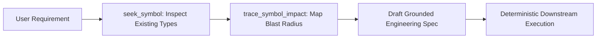
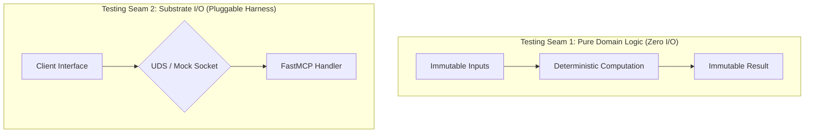

# To-Spec: Requirements Synthesis & Specification Framework

The `to-spec` skill governs the transformation of high-level conversational intent, ambiguous feature requests, and product briefs into battle-tested, unambiguous engineering specifications. It bridges the gap between product requirements and downstream task execution, ensuring implementation agents receive deterministic, grounded instructions.

---

## 1. The Anti-Interview Fatigue Principle

A frequent failure mode of AI-assisted engineering is "interview fatigue": interrogating the user with dozens of trivial, open-ended questions before writing a single line of design.

```mermaid
flowchart TD
    subgraph WRONG["❌ Interview Fatigue Anti-Pattern"]
        U1[Ambiguous Request] --> Q1[Ask 15 Open-Ended Questions]
        Q1 --> U2[User Exertion & Cognitive Burden]
        U2 --> Q2[Follow-up clarification loop]
        Q2 --> Delay[Stalled Initiative]
    end

    subgraph CORRECT["✅ Synthesis with Sensible Defaults"]
        U3[Ambiguous Request] --> Ground[Ground in Codebase via seek_symbol]
        Ground --> Draft[Draft Opinionated Spec with Defaults & Trade-offs]
        Draft --> Review[Present Concrete Options for User Approval]
        Review --> Fast[Immediate Momentum]
    end
```



### The Golden Rule: Propose First, Inquire Sparingly
1. **Never Ask Blank Questions:**
   - ❌ *Bad:* "What database schema do you want for this?"
   - ✅ *Good:* "I propose storing session checkpoints as frozen Pydantic dataclasses in FalkorDB with a TTL index on `created_at`. Should we deviate from this standard pattern?"
2. **Select Sensible Defaults:**
   - Adopt prevailing architectural patterns already present in the codebase.
   - Default to standard project invariants: strict immutability, parameterized queries, and Unix domain sockets.
3. **Quarantine Real Ambiguities:**
   - Limit human queries strictly to fundamental architectural forks or business policy decisions (e.g., destructive migration vs. backwards compatibility window).
   - Format questions as multiple-choice options with a declared recommendation:
     > *"Recommendation: Option A (Bi-temporal invalidation). Rationale: Preserves auditability with zero breaking schema changes. Let me know if you prefer Option B (in-place soft deletion)."*

---

## 2. Kortext Superpower: AST Grounding via `seek_symbol`

Hallucinated interfaces and speculative classes derail specifications. When engineering specifications reference fictitious functions or obsolete types, downstream implementation tasks fail during compilation or testing.

### Deterministic Codebase Grounding
Before authoring the specification, invoke `seek_symbol` and `trace_symbol_impact` to ground the design in actual production types and signatures:



1. **Inspect Actual Type Contracts:**
   ```python
   # Locate existing contracts before designing extensions
   symbol_info = seek_symbol(symbol_name="BaseSessionState")
   # Returns: exact file, line span, frozen dataclass fields, type annotations
   ```
2. **Verify Interface Seams:**
   - Confirm parameter names, return types, error classes, and protocol definitions.
   - Reference existing constants and configuration models instead of inventing new keys.
3. **Assess Caller Blast Radius:**
   ```python
   # Check which components will be impacted by extending the interface
   impact = trace_symbol_impact(symbol="BaseSessionState", direction="upstream")
   ```
4. **Embed Exact Code References in the Spec:**
   - Always link directly to real file paths and symbols (e.g., [`SessionRegistry`](file:///path/to/registry.py#L42)).

---

## 3. Standard Engineering Specification Structure

Every specification produced by `to-spec` must adhere to this comprehensive, battle-tested structure:

```markdown
# [SPEC-xxx] Feature / System Title

## 1. Problem Statement & Motivation
- **Context:** Background and business/system context.
- **Pain Point:** Concrete limitation, bug, or missing capability being solved.
- **Expected Outcome:** High-level definition of success.

## 2. Architectural Design & System Flow
- **High-Level Topology:** Mermaid diagram illustrating component interactions.
- **Data Model & Contracts:** Grounded types, schemas (frozen Pydantic/dataclasses), and state transitions.
- **Substrate Interactions:** IPC sockets, queries, and storage patterns.

## 3. User Stories
- Narrative user journeys establishing end-to-end functionality:
  - *As a [role/system], I want [capability], so that [business value/benefit].*

## 4. Acceptance Criteria (Gherkin / Scenario-Based)
- Concrete, testable assertions using Given-When-Then or clear bulleted checklists:
  - **Scenario 1:** Happy Path Execution
    - Given ...
    - When ...
    - Then ...
  - **Scenario 2:** Error / Boundary Condition
    - Given ...
    - When ...
    - Then ...

## 5. Non-Functional Requirements (NFRs)
- **Performance & Latency:** Latency budgets (e.g., <5ms graph lookups).
- **Concurrency & Thread Safety:** Lock-free invariants, immutability, thread boundaries.
- **Resource Limits:** Token budgets, memory bounds, connection pool sizes.
- **Security & Authorization:** Parameterized queries, input sanitization, zero hardcoded secrets.

## 6. Edge Cases & Failure Modes
- Explicit enumerations of boundary conditions:
  - Null/None values, empty strings, oversized payloads.
  - Substrate offline or socket connection drops (graceful degradation).
  - Race conditions, concurrent writes, idempotent retries.

## 7. Testing Seams & Verification Plan
- **Unit Test Seams:** Isolated domain logic testable with pure in-memory inputs.
- **Integration Test Seams:** UDS/TCP mock or live socket test harnesses.
- **Test Command:** Exact command to run (e.g., `uv run pytest tests/test_feature.py`).
- **Minimum Coverage Target:** 80%+ branch and line coverage.
```

---

## 4. User Story & Acceptance Criteria Standards

### User Story Format
User stories must capture clear intent and downstream value:
- `As a Developer using Kortext, I want atomic session state serialization, so that session context survives process restarts without data corruption.`
- `As an Autonomous Agent, I want to query ready DAG tasks via FalkorDB, so that I can dispatch execution workers without manual orchestrator polling.`

### Acceptance Criteria Format
Acceptance criteria must be deterministic and binary (pass or fail). Avoid ambiguous language like "fast", "user-friendly", or "robust".

| ❌ Ambiguous (Rejected) | ✅ Deterministic & Testable (Accepted) |
|---|---|
| The API should be fast. | Query response latency must be `< 15ms` at the 99th percentile across 1,000 requests. |
| Errors should be handled nicely. | Returns `Result.Err(SubstrateConnectionTimeout)` when socket ping exceeds `500ms`; logs error with stack trace and returns HTTP 504. |
| Models should be immutable. | Data model is declared with `@dataclass(frozen=True)` or Pydantic `ConfigDict(frozen=True)`; mutating any attribute raises `FrozenInstanceError`. |

---

## 5. Designing Explicit Testing Seams

A specification is only as good as its verifiability. Every architectural design must specify clean testing seams:



### Three Inviolable Testing Seams:
1. **Pure Functional Domain Seam:**
   - Extract validation, parsing, state calculation, and diffing algorithms into pure functions.
   - Ensures unit tests run in <10ms with zero test doubles or filesystem access.
2. **Protocol / Client Adapter Seam:**
   - Abstract external substrate communication (FalkorDB socket, Qdrant FastMCP) behind typed interfaces.
   - Allows straightforward test double injection without patching globals.
3. **End-to-End Verification Gate:**
   - Provide the complete, automated test invocation command.
   - Specify deterministic test fixtures and tear-down cleanups.

---

## 6. To-Spec Quality Checklist

Before finalizing any specification document:

- [ ] **No Interview Fatigue:** Sensible defaults and opinionated recommendations provided for all technical forks.
- [ ] **AST Grounded:** Existing symbols and types verified via `seek_symbol`; zero hallucinated APIs.
- [ ] **Immutability Enforced:** Data contracts specify frozen models and pure return types.
- [ ] **Binary Acceptance Criteria:** All acceptance criteria are objectively verifiable as pass/fail.
- [ ] **Failure Modes Enumerated:** Boundary cases (timeouts, empty sets, invalid inputs) explicitly documented.
- [ ] **Testing Seams Defined:** Clear separation between pure computation and substrate I/O.
