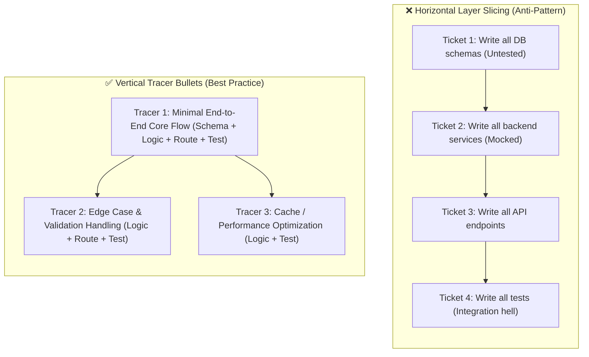
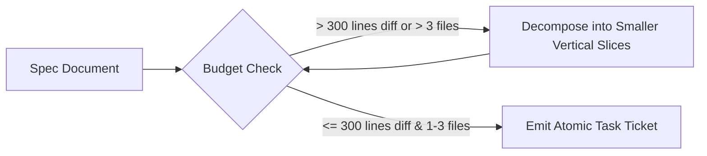
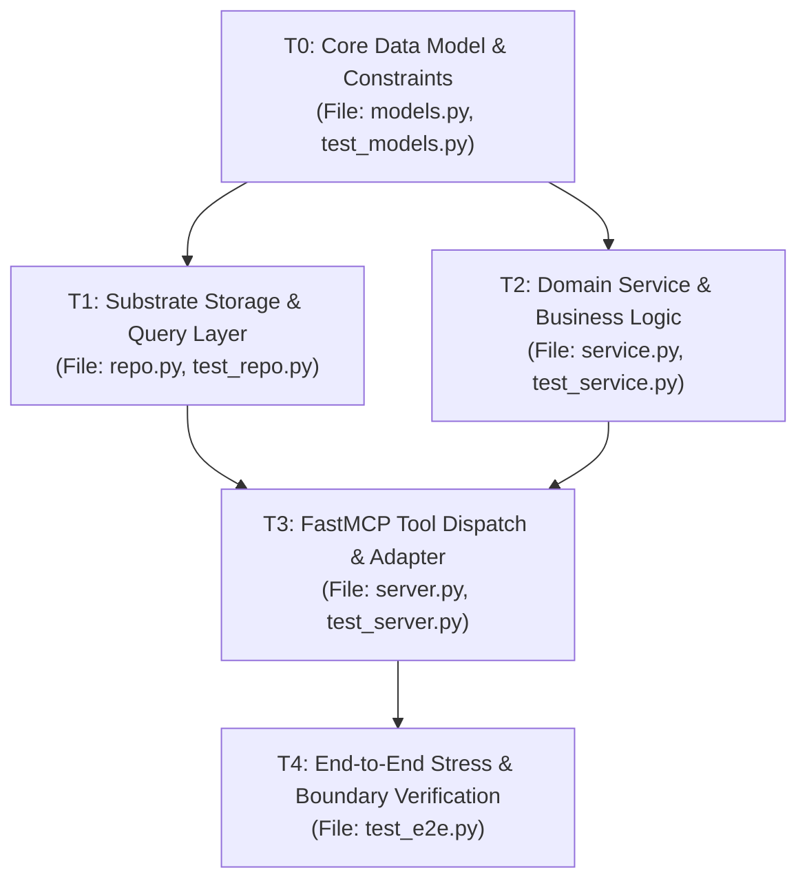

# To-Tickets: Specification Slicing & Task DAG Generation

The `to-tickets` skill converts comprehensive engineering specifications into small, atomic, vertical tracer bullet tasks. It builds directed acyclic task graphs (DAGs) optimized for parallel subagent execution, ensuring that each task fits within a single agent context window and can be verified deterministically.

---

## 1. The Vertical Tracer Bullet Philosophy

A foundational tenet of robust software engineering is slicing work **vertically** across architectural tiers rather than horizontally across technical layers.



### Why Horizontal Slicing Fails in Agentic Swarms
- **Deferred Feedback:** Bugs in the schema are only discovered days later when API routes or integration tests are written.
- **Context Fragmentation:** Workers have no concrete proof that the code actually runs end-to-end.
- **Mock Drift:** Mocking layers that don't yet exist produces speculative interfaces that collapse under integration.

### The Vertical Tracer Bullet Approach
Every tracer bullet pierces through the entire stack for a single, narrow feature slice:
1. **Schema:** Concrete data contracts and models.
2. **Logic:** Pure domain calculation and state transitions.
3. **API / Tool Interface:** FastMCP tool handler, CLI command, or UDS/TCP route.
4. **Automated Verification:** 100% passing unit and integration tests proving the slice works.

---

## 2. Context Window Budgeting (<300 Lines Diff, 1-3 Files)

Subagents perform with the highest reliability, accuracy, and adherence to invariants when working within a bounded context scope. Large, sprawling tasks trigger context exhaustion, hallucinations, and unrecoverable regressions.



### Context Budgeting Rules:
1. **The 300-Line Diff Ceiling:**
   - Any task expected to generate more than 300 lines of code (including tests) must be sliced into smaller increments.
2. **The 1-to-3 File Limit:**
   - A single task must touch at most 1-3 related files (e.g., `model.py`, `service.py`, `test_service.py`).
   - If changes span across multiple submodules or domains, split the work into separate sequential tasks.
3. **The 15-Minute Execution Ceiling:**
   - An isolated subagent worker must be able to comprehend context, write failing tests, implement the minimal solution, and run the test suite in under 15 minutes.
4. **Zero Ambient Dependencies:**
   - All required interfaces, types, and preconditions must either already exist in the codebase or be produced by an explicit blocking parent task.

---

## 3. Dependency Graph Construction & Task DAG Creation

Once tracer bullets are identified, they are linked into a directed acyclic graph (DAG) in FalkorDB via `manage_tasks(action='create')`.

### 3.1 Establishing Explicit Dependency Edges
Every task must declare its dependencies explicitly. In Kortext, dependencies form causal graph edges (`[:BLOCKS]` / `[:DEPENDS_ON]`):



### 3.2 Programmatic DAG Registration via `manage_tasks`
Construct tickets and pass them directly to the task manager:

```python
# Slicing a spec into atomic DAG tasks
tasks = [
    {
        "id": "TASK_001_MODELS",
        "name": "Implement SessionCheckpoint Models & Invariants",
        "archetype": "Task",
        "description": "Define frozen Pydantic models for SessionCheckpoint with bi-temporal interval validators.",
        "files_to_modify": ["src/kortext/models/checkpoint.py", "tests/test_checkpoint_models.py"],
        "depends_on": [],
        "test_command": "uv run pytest tests/test_checkpoint_models.py -q",
    },
    {
        "id": "TASK_002_REPO",
        "name": "Implement FalkorDB Checkpoint Persistence",
        "archetype": "Task",
        "description": "Write parameterized Cypher queries for checkpoint upserts over UDS socket.",
        "files_to_modify": ["src/kortext/storage/checkpoint_repo.py", "tests/test_checkpoint_repo.py"],
        "depends_on": ["TASK_001_MODELS"],
        "test_command": "uv run pytest tests/test_checkpoint_repo.py -q",
    },
    {
        "id": "TASK_003_TOOL",
        "name": "Expose Checkpoint Management via FastMCP",
        "archetype": "Task",
        "description": "Implement checkpoint_session and restore_session FastMCP tools with safe error envelopes.",
        "files_to_modify": ["src/kortext/server/tools/checkpoints.py", "tests/test_checkpoint_tools.py"],
        "depends_on": ["TASK_002_REPO"],
        "test_command": "uv run pytest tests/test_checkpoint_tools.py -q",
    },
]

manage_tasks(action="create", tasks=tasks)
```

---

## 4. Definition of Done (DoD) per Ticket

Every ticket produced by `to-tickets` must contain a non-negotiable Definition of Done. A worker subagent cannot mark a task complete without satisfying all criteria:

```markdown
### Definition of Done (DoD) Checklist
1. [ ] **Test-Driven Development (TDD):**
   - Failing test written first (RED phase verified).
   - Minimal implementation satisfies assertions (GREEN phase verified).
   - Refactored cleanly with zero dead code or duplication (REFACTOR phase).
2. [ ] **Test Suite 100% Green:**
   - Dedicated test suite passes completely: `{test_command}`.
   - Zero regressions in the global project test suite: `uv run pytest -q`.
3. [ ] **Strict Immutability & Typing:**
   - Frozen dataclasses/Pydantic models utilized.
   - Comprehensive type annotations on all parameters and return values.
4. [ ] **Security & Substrate Invariants:**
   - Parameterized queries (no string concatenation in Cypher/SQL).
   - Zero hardcoded secrets, keys, or credentials.
   - Proper error envelopes (no unhandled exceptions crashing background processes).
5. [ ] **Context & Scope Discipline:**
   - Total diff under 300 lines.
   - Only declared target files modified.
6. [ ] **Structured Completion Handoff:**
   - Returns valid JSON payload to parent orchestrator.
```

---

## 5. Ticket Specification Schema

When writing individual tickets into markdown or task registries, use this structured template:

```markdown
### [TASK-ID]: Concise Imperative Title

- **Archetype:** Task | Prototype | Research | Grilling
- **Scope Budget:** <300 lines diff, [1-3] files
- **Target Files:**
  - `src/module/subsystem.py` (implementation)
  - `tests/test_subsystem.py` (unit tests)
- **Dependencies:** [TASK-ID-PREV]
- **Target Symbols (AST):**
  - Locate existing hooks via `seek_symbol(symbol_name="TargetSymbol")`
- **Objective:**
  Concise 2-3 sentence description of the minimal increment to implement.
- **Verification Command:**
  `uv run pytest tests/test_subsystem.py -q`
- **Definition of Done:**
  - Passes verification command with 100% green rate.
  - No mutations or global state side effects.
  - JSON handoff delivered to parent.
```

---

## 6. To-Tickets Quality Checklist

Before submitting a task decomposition for execution:

- [ ] **Vertical Slices:** Are tickets structured as vertical tracer bullets rather than horizontal layers?
- [ ] **Context Sizing:** Is each ticket sized for a single subagent context window (<300 lines, 1-3 files)?
- [ ] **Explicit Dependencies:** Are blocking prerequisites defined and acyclic?
- [ ] **Deterministic Verification:** Does every ticket specify an exact test command?
- [ ] **Registered in Substrate:** Are tasks durably registered in FalkorDB via `manage_tasks(action='create')`?
