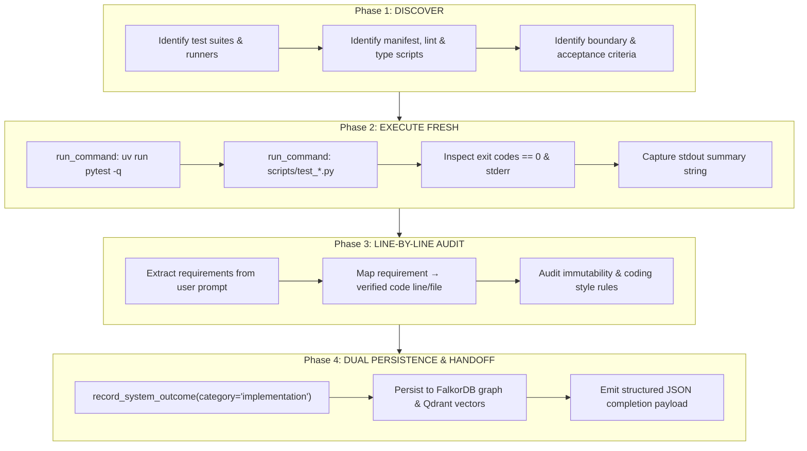

# Verification Before Completion Protocol

An ironclad verification gate and pre-completion protocol. Every task completion claim must be grounded in freshly executed test suites, line-by-line acceptance criteria validation, deterministic evidence capture, and dual graph-journal persistence.

## When to Activate

- Before declaring any task, subtask, or bug fix completed
- Before sending a completion handoff message to a parent orchestrator
- Before updating Task DAG state to `completed` in `manage_tasks`
- Before opening a pull request or concluding an autonomous execution loop

---

## The Iron Verification Rule

> **NEVER claim completion based on assumptions, stale test runs, or partial execution.**

- If a test was run in a previous turn or before the last code edit, it is **INVALID**.
- Speculative claims ("this should work", "the logic looks sound", "tests ought to pass") are strictly prohibited.
- A task is complete **ONLY** when verified by fresh execution in the current turn with exit code `0` and captured stdout evidence.
- **No fresh evidence = No completion.**

---

## The 4-Phase Verification Flow



---

## Phase 1: Authoritative Command Discovery

Identify all authoritative verification commands required for the project:

### 1. Test Suites
- Python: `uv run pytest -q` or targeted `uv run pytest path/to/test_file.py`
- Node/TypeScript: `pnpm test`, `npm test`, or `bun test`
- Rust/Go: `cargo test` or `go test ./...`

### 2. Manifest & Schema Checks
- Antigravity plugin and agent manifests:
  ```bash
  python3 scripts/test_plugin_manifest.py
  ```

### 3. Static Analysis & Type Checking
- Python: `uv run ruff check .` and `uv run mypy <modified_files>`
- TypeScript: `npx tsc --noEmit`

### 4. Substrate Health Verification
- FastMCP / FalkorDB socket connectivity:
  ```python
  check_kortext_health()
  ```

---

## Phase 2: Fresh Execution in Current Turn

Execute the authoritative verification commands **in the current turn** via `run_command`:

1. **Invoke synchronously or monitor background task to completion:**
   ```bash
   uv run pytest -q
   ```
2. **Inspect Process Exit Code:**
   - Exit code must strictly equal `0`.
   - If exit code $\ne 0$, **STOP**. Do NOT proceed to handoff. Diagnose the root cause using the systematic debugging protocol.
3. **Inspect Standard Error:**
   - Ensure zero unhandled exceptions, hidden tracebacks, or swallowed warnings.
4. **Extract Verifiable Summary String:**
   - Capture exact counts and timing, e.g.:
     `"581 passed in 11.43s"`
     `"All Kortext manifest tests passed!"`

---

## Phase 3: Line-by-Line Acceptance Criteria Validation

Audit every specific requirement from the user prompt or Task DAG specification:

### Acceptance Criteria Checklist Table

Construct an explicit checklist mapping every requirement to empirical proof:

| # | Requirement | Implementation Target | Verification Evidence | Status |
|---|---|---|---|---|
| 1 | Safe expand-contract lifecycle | `skills/expand-contract-refactor/SKILL.md` | Tested 3 phases + AST caller graphing | ✅ PASS |
| 2 | Fresh execution gate | `skills/verification-before-completion/SKILL.md` | Zero-assumption rule + exit code gate | ✅ PASS |
| 3 | ADR domain terminology & memory | `skills/architecture-decision-records/SKILL.md` | `GLOSSARY.md` alignment + FalkorDB persistence | ✅ PASS |
| 4 | Manifest validity | `scripts/test_plugin_manifest.py` | Exit code 0, all manifests valid | ✅ PASS |

### Boundary & Code Hygiene Checks
- **Immutability:** No mutable default arguments, no in-place mutation of input parameters.
- **File Lengths:** Source files under 400 lines typical (800 ceiling). Functions under 50 lines.
- **Error Handling:** Explicit exception handling; zero bare `except Exception: pass`.
- **AST Navigation:** Zero brute-force `ripgrep` for symbols; AST `seek_symbol` used.

---

## Phase 4: Dual Persistence & Structured Handoff

### 1. Dual Episodic Persistence
Persist the verified implementation outcome to FalkorDB and Qdrant memory:

```python
record_system_outcome(
    decision="Implemented <feature_or_task_name>",
    rationale="All 4 verification phases completed. Fresh test suite passed with zero regressions. Line-by-line acceptance criteria 100% satisfied.",
    category="implementation",
)
```

This creates an `(:Episodic)` outcome node in FalkorDB and an embedded vector chunk in Qdrant, enabling cross-session associative retrieval.

### 2. Structured Handoff Payload
Return a clean, structured JSON handoff to the parent orchestrator via `send_message`:

```json
{
  "task_id": "task_xxxx",
  "status": "completed",
  "modified_files": [
    "/absolute/path/to/modified_file1.py",
    "/absolute/path/to/modified_file2.md"
  ],
  "tests_passed": true,
  "test_summary": "581 passed in 11.43s",
  "evidence": "Fresh execution confirmed exit code 0. Validated all acceptance criteria line-by-line. Manifest tests 100% green."
}
```

---

## Anti-Patterns to Avoid

| Anti-Pattern | Failure Mode | Remedy |
|---|---|---|
| **Assumption-Based Completion** | Claiming code "should work" without running tests leads to broken production builds. | Execute fresh tests in the current turn before any handoff. |
| **Stale Verification** | Relying on a test run from 3 turns ago before making a "minor typo fix". | Re-run verification suite after ANY code change. |
| **Partial Suite Run** | Running 1 unit test while breaking 5 integration tests. | Run targeted test first, then run the full suite (`uv run pytest -q`). |
| **Ignored Warnings** | Dismissing deprecation or runtime warnings that later cause failures in strict CI. | Inspect stderr and address root causes. |
| **Unanchored Handoff** | Reporting "done" without evidence or modified files list. | Output the standardized JSON handoff payload with full metrics. |

---

## Pre-Handoff Checklist

Before reporting completion to the user or parent agent:
- [ ] Fresh test suite executed in the current turn (`exit_code == 0`)
- [ ] Manifest and schema validation passed (`python3 scripts/test_plugin_manifest.py`)
- [ ] Every requirement from user prompt audited line-by-line
- [ ] Immutability, file size, and coding style rules verified
- [ ] Outcome persisted via `record_system_outcome(category='implementation', ...)`
- [ ] Structured JSON completion payload prepared with exact test summary evidence
