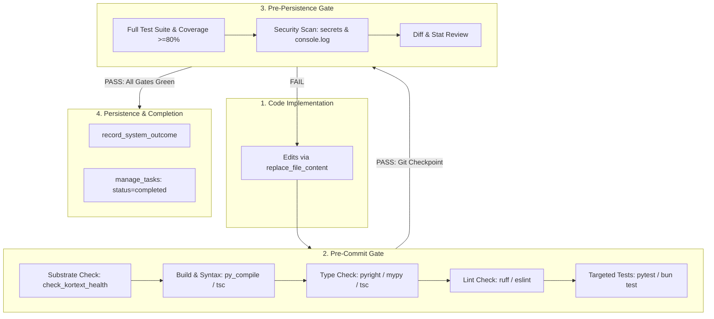

# Pre-Persistence Verification Loop

A comprehensive quality gate and verification system for development sessions. Validates builds, types, linters, test coverage, security, and diffs before committing code or recording system outcomes in episodic memory.

## When to Use

Invoke this verification loop:
- After completing a feature or significant code modification
- Before creating a Git commit or opening a pull request (Pre-Commit Gate)
- Before calling `record_system_outcome` or completing a Task DAG node (Pre-Persistence Gate)
- After refactoring existing abstractions
- Before session handoffs (`memory_session_handoff`)

---

## The Dual-Gate Architecture



---

## Verification Phases

### Phase 1: Build & Substrate Verification

```bash
# Verify Kortext substrate health
python -c "from kortext.server import check_kortext_health; import asyncio; print(asyncio.run(check_kortext_health()))" 2>/dev/null || true

# TypeScript / Node.js build
npm run build 2>&1 | tail -20
# OR
pnpm build 2>&1 | tail -20

# Python syntax check
python -m py_compile $(git diff --name-only | grep '\.py$')
```

If the build or substrate check fails, **STOP** and fix the error before proceeding.

---

### Phase 2: Type Check

```bash
set -o pipefail

# TypeScript projects
npx --no-install tsc --noEmit 2>&1 | head -30

# Python projects
uv run mypy $(git diff --name-only | grep '\.py$') 2>&1 | head -30
# OR
pyright . 2>&1 | head -30
```

Report all type errors. Resolve type mismatches before proceeding.

---

### Phase 3: Lint Check

```bash
# JavaScript / TypeScript
npm run lint 2>&1 | head -30

# Python
uv run ruff check . 2>&1 | head -30
```

---

### Phase 4: Test Suite & Coverage

```bash
# JavaScript / TypeScript
npm run test -- --coverage 2>&1 | tail -50

# Python (minimum 80% coverage target)
uv run pytest --cov=. --cov-report=term-missing 2>&1 | tail -50
```

Report:
- Total tests: `X`
- Passed: `X`
- Failed: `0`
- Coverage: `X%` (Threshold: $\ge 80\%$)

---

### Phase 5: Security Scan

```bash
# Check for accidental hardcoded secrets
grep -rn "sk-" --include="*.ts" --include="*.js" --include="*.py" . 2>/dev/null | head -10
grep -rn "api_key" --include="*.ts" --include="*.js" --include="*.py" . 2>/dev/null | head -10

# Check for debug print/console slop in source files
grep -rn "console.log" --include="*.ts" --include="*.tsx" src/ 2>/dev/null | head -10
grep -rn "print(" --include="*.py" kortext/ 2>/dev/null | head -10
```

---

### Phase 6: Diff Review

```bash
# Show summary of changed files
git diff --stat

# Inspect modified files
git diff HEAD~1 --name-only
```

Review each changed file for:
- Unintended edits or debug comments
- Missing error boundaries
- Unchecked boundary conditions

---

## Output Format: Verification Report

After completing all phases, summarize results:

```
VERIFICATION REPORT
==================

Substrate: [PASS/FAIL]
Build:     [PASS/FAIL]
Types:     [PASS/FAIL] (0 errors)
Lint:      [PASS/FAIL] (0 warnings)
Tests:     [PASS/FAIL] (X/X passed, Y% coverage)
Security:  [PASS/FAIL] (0 secrets detected)
Diff:      [X files changed]

Overall:   [READY / NOT READY]
```

---

## Pre-Persistence Outcome Recording via `record_system_outcome`

Once all verification gates pass and the implementation is confirmed, persist the outcome to Kortext episodic memory:

```python
record_system_outcome(
    decision="Implemented and verified [Feature/Fix Description]",
    rationale="All 6 verification phases passed with 100% test pass rate and >=80% coverage.",
    category="verification"
)
```

If updating a Task DAG in FalkorDB:
```python
manage_tasks(
    action="update_status",
    task_id="task_123",
    status="completed"
)
```

---

## Continuous Mode

For long sessions, run verification checkpoints:
- After completing each discrete function or component
- Before moving to the next task in the DAG
- Before any git commit or push

---

## Integration with Hooks

This skill complements automated PostToolUse and Pre-Commit hooks. While hooks provide immediate syntactic feedback, this verification loop enforces holistic system integrity.
