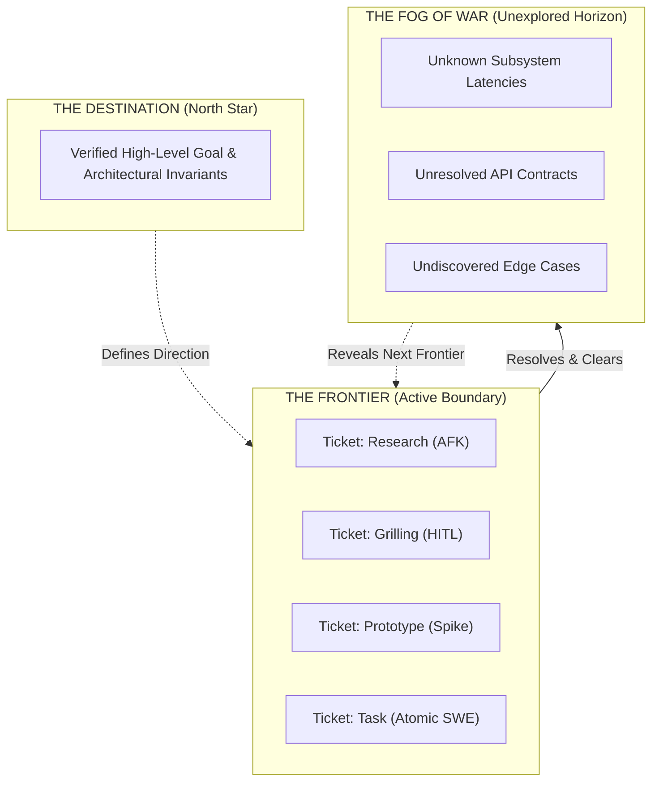
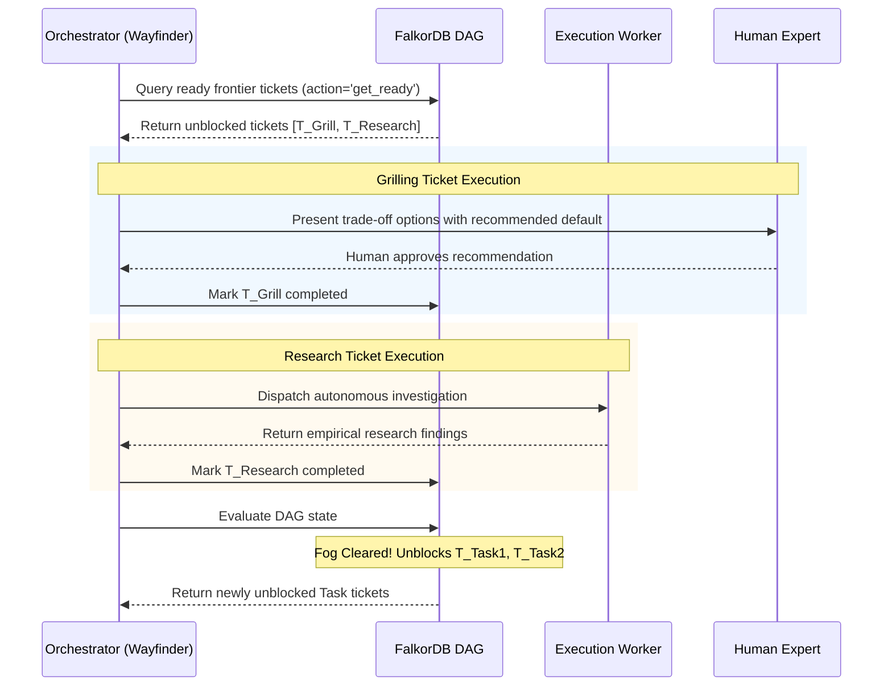

# Wayfinder: Large-Scale Initiative Charting Framework

Wayfinder is an engineering navigation framework designed to steer complex, ambitious initiatives from ambiguous problem spaces to verified production software. It prevents wandering, premature implementation, and cognitive drift across long-horizon projects by maintaining explicit boundaries between known terrain, actionable edges, and unexplored territory.

---

## 1. The Wayfinder Mental Model

Navigating any non-trivial engineering initiative requires tracking three distinct conceptual zones:



### 1.1 The Destination (North Star)
- **What it is:** The concrete, end-state vision of what the system must accomplish.
- **Characteristics:** High-level, invariant-focused, measurable.
- **Rule:** The Destination defines *what* victory looks like (e.g., "Full dual-memory substrate with sub-10ms retrieval and zero SQLite locking"), never fluctuating mid-stride without an explicit architectural decision record (ADR).

### 1.2 The Frontier (Active Exploration Boundary)
- **What it is:** The immediate perimeter of actionable work where uncertainty is actively converted into code, specifications, or validated decisions.
- **Characteristics:** High-clarity, bounded scope, unblocked dependencies.
- **Rule:** All agent execution occurs strictly along the Frontier. Work is never dispatched into the Fog of War before the blocking frontier tickets are resolved.

### 1.3 The Fog of War (Unexplored Horizon)
- **What it is:** Speculative, unvalidated, or downstream architectural zones where dependencies, interfaces, or constraints remain unknown.
- **Characteristics:** High entropy, incomplete assumptions, downstream risks.
- **Rule:** Do NOT write production code or create granular implementation tickets deep inside the Fog of War. When fog is encountered, deploy frontier probes (Research, Prototype, or Grilling) to illuminate the terrain first.

---

## 2. The Four Ticket Archetypes

Wayfinder categorizes all work into four specialized archetypes. Selecting the correct archetype prevents wasted execution cycles and aligns agent autonomy with human oversight.

| Archetype | Autonomy Mode | Primary Objective | Output Artifact |
|---|---|---|---|
| **`Research`** | Fully Autonomous (AFK) | Deep-dive investigation of libraries, protocols, algorithms, or substrate capabilities. | Research brief, comparative matrix, benchmark summary. |
| **`Prototype`** | Rapid Spike (HITL Verification) | Minimal end-to-end vertical tracer spike to validate feasibility or uncover hidden bottlenecks. | Disposable branch, benchmark metric, or tracer diff. |
| **`Grilling`** | Interactive Human Dialogue | High-intensity alignment dialogue to iron out contentious architectural trade-offs, constraints, or UX decisions. | Signed-off decision record (ADR) or spec amendment. |
| **`Task`** | Atomic SWE Execution | Deterministic implementation of a fully specified unit of production code following TDD. | Production code diff + 100% passing automated tests. |

### 2.1 Research Tickets (Autonomous Deep Dives, AFK)
- **Purpose:** Answer concrete technical questions when documentation is complex or substrate behavior is unclear.
- **Execution Mode:** Background subagent (`kortext-researcher`), zero human interruption needed.
- **Trigger Conditions:**
  - "Can FalkorDB handle 50 concurrent socket transactions under <2ms latency?"
  - "What are the breaking changes between v1 and v2 of this upstream library?"
- **Exit Criteria:** A concise markdown summary with concrete recommendations, citations, and risk analysis.

### 2.2 Prototype Tickets (Rapid Vertical Tracer Spikes)
- **Purpose:** Prove or disprove architectural feasibility through hands-on code execution before committing to full productionization.
- **Execution Mode:** Rapid tracer spike, minimal error handling, throwaway code allowed.
- **Human-in-the-Loop (HITL):** Results are demonstrated to the orchestrator/human for validation.
- **Exit Criteria:** Working proof-of-concept demonstrating critical path feasibility; identified failure modes documented; clear verdict on whether to proceed.

### 2.3 Grilling Tickets (Structured Design Alignment Dialogue)
- **Purpose:** Resolve ambiguous trade-offs, philosophical choices, product priorities, or system boundary questions directly with the human.
- **Execution Mode:** Synchronous dialogue; the agent presents structured alternatives, trade-offs, and recommended defaults rather than open-ended questions.
- **Rules of Grilling:**
  1. *Never ask blank questions:* Present Option A vs. Option B with pros/cons and a stated recommendation.
  2. *Defend the architecture:* Challenge assumptions if they violate core system invariants.
  3. *Enforce closure:* Cap grilling sessions to 3-5 tightly scoped decisions and immediately capture outcomes into specifications.
- **Exit Criteria:** Decided architectural choice recorded, unblocking downstream `Task` tickets.

### 2.4 Task Tickets (Concrete Implementation Steps)
- **Purpose:** Execute bounded production engineering work under strict Test-Driven Development (TDD).
- **Execution Mode:** Worker subagent (`kortext-task-runner`).
- **Characteristics:**
  - Scoped to a single context window (<300 lines diff, 1-3 files).
  - Explicit entry/exit points (known symbols discovered via `seek_symbol`).
  - Pre-defined test command with 100% pass requirement.
- **Exit Criteria:** Green test suite, clean linting, AST invariant compliance, structured JSON completion handoff.

---

## 3. Frontier Resolution Protocol

The Frontier is dynamic: as tickets complete, the boundary advances, dissolving Fog of War and revealing new frontier tickets.



### Step-by-Step Protocol:
1. **Survey the Frontier:**
   - Ingest current graph state to identify all unblocked tickets (`dependencies_satisfied == True`).
2. **Prioritize Uncertainty Reduction First:**
   - If a `Grilling` or `Research` ticket blocks multiple `Task` tickets, execute it first. Resolving uncertainty early prevents downstream rework.
3. **Dispatch Atomic Units:**
   - Assign unblocked tickets to isolated worker subagents.
   - Maintain context hygiene: parent orchestrators never run implementation loops directly.
4. **Digest Handoff & Update Topology:**
   - Upon receiving completion handoffs, mark the ticket completed in FalkorDB.
   - Re-evaluate downstream blocked nodes.
5. **Chart New Territory (Fog Elimination):**
   - As new information emerges from completed prototypes or research, slice newly illuminated areas into concrete `Task` tickets and link them into the graph.

---

## 4. Kortext Superpower: Graph-Backed Dependency Management

In Kortext, Wayfinder is not a passive checklist—it is backed by the FalkorDB knowledge graph substrate. Tasks and their causal dependencies form a directed acyclic graph connected via `[:BLOCKS]` and `[:DEPENDS_ON]` edges.

### 4.1 Querying the Frontier via `manage_tasks`

Subagents and orchestrators query unblocked frontier tickets instantly in <2ms:

```python
# Query frontier tickets ready for immediate execution
ready_tasks = manage_tasks(
    action="get_ready",
    limit=5
)
```

The underlying graph substrate executes a deterministic Cypher traversal:
```cypher
MATCH (t:Task {status: 'pending'})
WHERE NOT EXISTS {
    MATCH (blocker:Task)-[:BLOCKS]->(t)
    WHERE blocker.status <> 'completed'
}
RETURN t.id, t.name, t.archetype, t.priority
ORDER BY t.priority DESC
```

### 4.2 Registering Initiative Graph Structures

When decomposing a high-level initiative, register the nodes and edges explicitly:

```python
# Create tickets with explicit dependencies
manage_tasks(
    action="create",
    tasks=[
        {
            "id": "T_RESEARCH_AUTH",
            "name": "Investigate OIDC Substrate Integration",
            "archetype": "Research",
            "description": "Benchmark token validation overhead and session store latency",
        },
        {
            "id": "T_GRILL_SCOPES",
            "name": "Align on Permission Scope Hierarchy",
            "archetype": "Grilling",
            "description": "Decide role-based vs fine-grained claim matrix with human",
        },
        {
            "id": "T_SPIKE_TOKEN",
            "name": "Vertical Tracer Token Validation",
            "archetype": "Prototype",
            "description": "Spike FastMCP auth header middleware with mock keys",
            "depends_on": ["T_RESEARCH_AUTH", "T_GRILL_SCOPES"],
        },
        {
            "id": "T_TASK_PROD_AUTH",
            "name": "Implement Production Auth Middleware",
            "archetype": "Task",
            "description": "Write frozen AuthContext models, validator, and unit tests",
            "depends_on": ["T_SPIKE_TOKEN"],
        }
    ]
)
```

### 4.3 Preserving Graph Invariants
- **No Orphan Nodes:** Every ticket must either contribute directly to the Destination or unblock a ticket that does.
- **Acyclic Enforcement:** FalkorDB rejects circular dependencies (`A -> B -> A`).
- **Atomic State Transitions:** State moves unidirectionally: `pending` -> `in_progress` -> `completed` (or `blocked`).

---

## 5. Wayfinder Checklist for Engineers & Agents

Before embarking on any initiative or declaring it complete:

- [ ] **Destination Anchored:** Is the end state clearly specified with measurable acceptance criteria?
- [ ] **Fog Mapped:** Have unknown risks been quarantined behind `Research` or `Grilling` tickets rather than speculative code?
- [ ] **Frontier Unblocked:** Are ready tickets identified using `manage_tasks(action='get_ready')`?
- [ ] **Archetypes Respected:** Are prototypes kept throwaway? Are grilling dialogues structured with sensible defaults?
- [ ] **Graph Integrity Maintained:** Are all state updates committed durably to FalkorDB?
