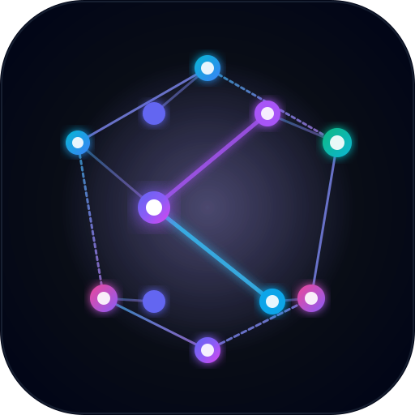
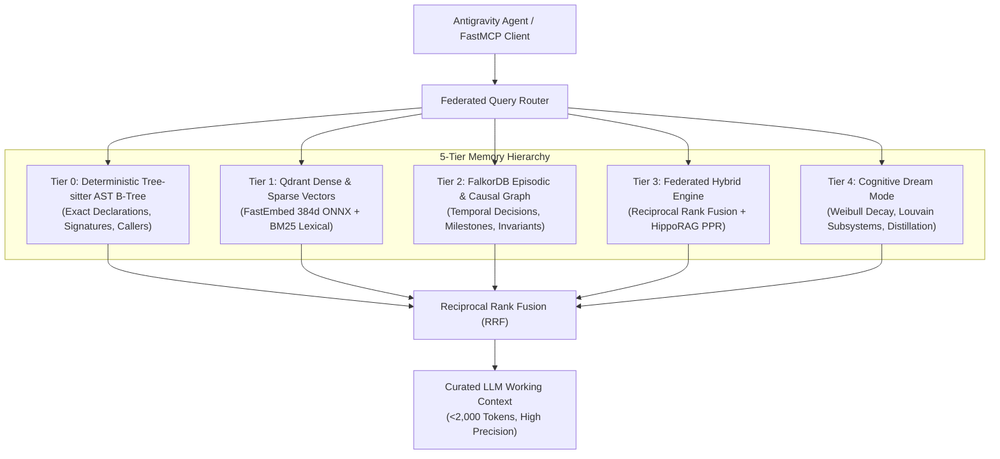

<div align="center">
  
  <h1>Kortext</h1>
  <p><strong>5-Tier Dual-Memory, AST Code Intelligence & Cognitive OS for Google Antigravity CLI</strong></p>

  <p>
    <a href="LICENSE"></a>
    <a href="pyproject.toml"></a>
    <a href="https://github.com/jlowin/fastmcp"></a>
    <a href="https://qdrant.tech/"></a>
    <a href="https://falkordb.com/"></a>
  </p>
</div>

---

**Kortext** is a stateful cognitive operating system and persistent dual-memory substrate designed for the **Google Antigravity CLI (`agy`)** and autonomous AI coding agents. It replaces lossy brute-force text scans and ephemeral prompt sessions with:
- **Compiler-Grade AST Intelligence:** Deterministic Tree-sitter symbol indexing and call hierarchies across 10+ languages (`seek_symbol`).
- **5-Tier Dual-Memory Hierarchy:** Graph memory (FalkorDB) + dense vector embeddings (Qdrant) unified by Reciprocal Rank Fusion (RRF) and HippoRAG Personalized PageRank (PPR).
- **Graph-Backed Task DAGs:** Multi-project task tracking with dependency resolution and subagent delegation for complex work ($C \ge 4$).
- **Hybrid Cognitive Dream Mode:** Weibull synaptic decay, Louvain community subsystem detection, AST body drift auditing, fact consolidation, and autonomous skill distillation.
- **Next-Gen Lifecycle Interceptors:** 5-pipeline guardrails intercepting lock contention, destructive commands, secret leaks, and MINJA prompt injections.
- **Interactive Anti-Hairball Dashboard:** Modular ES modules dashboard with real-time telemetry, 1-click Subsystems Architecture view, and a 5-column Drag-and-Drop Task DAG Kanban board.

Everything runs **100% locally and Zero-Docker native** without mandatory external cloud APIs.

---

## 📚 Complete Documentation Suite

Comprehensive, multi-chapter guides are available in the [`docs/`](docs/) directory:

| Guide | Description |
|:---|:---|
| 📖 **[1. System Architecture](docs/ARCHITECTURE.md)** | 5-Tier Memory Hierarchy, FastMCP Sole Custodian Model, UDS/TCP IPC, and multi-project isolation. |
| ⚡ **[2. AST Symbols & Anti-Ripgrep](docs/SYMBOLS_AST_GUIDE.md)** | Tree-sitter AST extraction, point lookup via `seek_symbol`, multi-hop blast radius via `trace_symbol_impact`, and orphan pruning. |
| 📋 **[3. Task DAG & Subagents](docs/TASK_DAG_AND_AGENTS.md)** | Subagent delegation ($C \ge 4$), the 5 specialized personas, the 5-round fix loop with model escalation, and outcome linking. |
| 🌙 **[4. Hybrid Dream Mode](docs/DREAM_MODE.md)** | Weibull synaptic decay, Louvain community partitioning, MEX pattern AST drift auditing, fact consolidation, and skill distillation. |
| 🛡️ **[5. Lifecycle Hooks & Guardrails](docs/LIFECYCLE_HOOKS.md)** | The 5-pipeline interceptor runner, LockGuard, CommandSafety, SecretLeakGuard, and MINJA causal memory injection defense. |
| 📊 **[6. Dashboard & CLI Reference](docs/DASHBOARD_AND_CLI.md)** | Modular ES modules dashboard, anti-hairball graph navigation, interactive Kanban board, and full `kortext` CLI command reference. |
| ⚖️ **[7. Trademark Policy](TRADEMARKS.md)** | Brand assets, proper usage guidelines, and fork attribution rules. |

---

## 🧠 5-Tier Memory Architecture

Kortext resolves queries through a unified 5-tier memory model:



---

## 🚀 Quick Start

### 1. Installation

Install Kortext using `uv` or `pip`:

```bash
# Clone the repository
git clone https://github.com/bravest-cat/cortex.git
cd cortex

# Install dependencies with uv
uv sync
```

### 2. Guided Setup Wizard

Run the interactive setup wizard to configure substrates, check ports, and initialize data directories:

```bash
# Interactive guided setup
uv run kortext setup

# Or non-interactive for automated CI environments
uv run kortext setup --non-interactive
```

### 3. Start Substrate Daemons

```bash
# Launch FalkorDB and background daemons
uv run kortext start

# Verify health status
uv run kortext status
```

### 4. Install the Antigravity Plugin

Install the plugin manifest, hooks, sidecars, and subagents into your local Antigravity environment:

```bash
python3 scripts/install_plugin.py
```

### 5. Launch the Visual Dashboard

```bash
uv run kortext dashboard --port 8000
# Open http://localhost:8000 in your browser
```

---

## 🛠️ FastMCP Tools Reference

Kortext exposes standardized FastMCP tools over `stdio` to Antigravity agents:

### 1. Deterministic Symbol Navigation
- **`seek_symbol(symbol_name)`**: Exact point lookup against the Tree-sitter AST index. Returns signature, file path, line numbers, and immediate callers in **<2ms** and **~120 tokens** (eliminating ripgrep token bleed).
- **`trace_symbol_impact(symbol, direction='upstream'|'downstream', max_depth=2)`**: Multi-hop recursive graph traversal over `kortext_symbols` assessing refactoring blast radius before modifying code.

### 2. Dual-Memory & Retrieval
- **`search_knowledge_and_memory(query, project=None, limit=5)`**: Federated 5-tier hybrid search across AST syntax, vector chunks, and episodic decision history.
- **`record_system_outcome(episode_name, content, category, project=None, tags=None)`**: Records technical decisions, bug fixes, and milestones. Enforces the **8-category outcome taxonomy** (`decision`, `roadmap`, `implementation`, `experiment`, `benchmark`, `investigation`, `research`, `report`) and persists to both FalkorDB and dated Markdown journals.
- **`trigger_dream_mode(project='kortext', purge_stale=True, consolidations=None, distilled_skills=None)`**: Triggers the 6-phase offline memory consolidation cycle.

### 3. Task DAG Management
- **`manage_tasks(action='create'|'get_ready'|'list_all'|'update_status', project_id='kortext', ...)`**: Manages graph-backed Task DAGs, unblocking dependent tasks and linking completed work to episodic outcomes (`[:PRODUCED_OUTCOME]`).

---

## 🧪 Verification & Test Suite

Kortext enforces strict verification before every release:

```bash
# Execute the full pytest test suite (100% pass required)
uv run pytest -q

# Validate all Antigravity plugin manifests, hooks, and subagent schemas
python3 scripts/test_plugin_manifest.py
```

---

## 📄 License

Kortext is licensed under the **GNU General Public License v3.0 (GPL-3.0)**. See the [LICENSE](LICENSE) file for the complete license text.

For trademark and branding policies, see [TRADEMARKS.md](TRADEMARKS.md).
