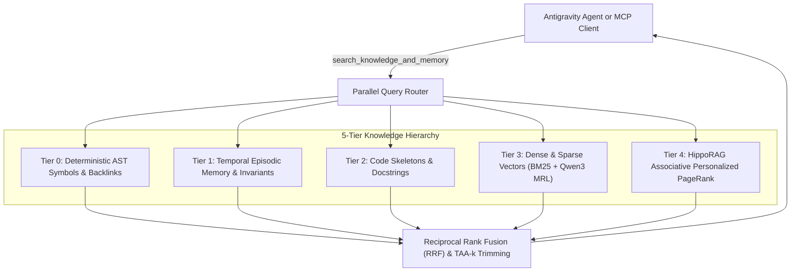

# Kortext

> 5-Tier Dual-Memory, AST Code Intelligence & Cognitive OS for Google Antigravity CLI

[](LICENSE)
[](pyproject.toml)
[](https://github.com/jlowin/fastmcp)
[](https://qdrant.tech/)
[](https://falkordb.com/)

Kortext is a persistent 5-tier memory and code intelligence system for the Google Antigravity CLI (`agy`) and autonomous AI coding agents. It pairs deterministic AST graphs and bi-temporal episodic records with dense vector search, Reciprocal Rank Fusion (RRF), and causal memory defenses. Everything runs locally without external cloud dependencies.

---

## 5-Tier Memory Architecture

Kortext organizes codebase context across five hierarchical memory tiers, resolving queries from exact syntax trees down to semantic text vectors:



| Tier | Source | Precedence | Description |
| :--- | :--- | :--- | :--- |
| **Tier 0: AST Symbols** | FalkorDB `kortext_symbols` | Ground Truth | Deterministic symbol declarations, definitions, and cross-file callers across 10 programming languages via Tree-sitter. |
| **Tier 1: Episodic Facts** | FalkorDB `kortext` | High | Decisions, architectural invariants, bug fixes, and configuration milestones. Overrides model assumptions. |
| **Tier 2: Code Structure** | Tree-sitter AST | Medium-high | Module skeletons, class signatures, and docstrings synced incrementally on file changes. |
| **Tier 3: Vector Embeddings** | Qdrant + BM25 | Medium | Hybrid dense and sparse lexical search over code chunks with cross-encoder reranking. |
| **Tier 4: Associative Graph** | HippoRAG PPR | Associative | Multi-hop Personalized PageRank linking episodic concepts with AST code symbols. |

---

## Quick Start

### 1. Requirements
- Docker Desktop or Docker Engine (or native FalkorDB and Qdrant)
- Python 3.11 or newer
- `uv` package manager
- Google Antigravity CLI (`agy`)

### 2. Setup

```bash
# Clone repository
git clone https://github.com/bravest-cat/cortex.git
cd cortex

# Install dependencies with uv
uv sync
```

### 3. Start Substrate Daemons

```bash
# Launch FalkorDB and substrate daemons
./scripts/start_kortext.sh
```

### 4. Install Plugin into Antigravity

```bash
python3 scripts/install_plugin.py
```

---

## FastMCP Tools Reference

Kortext exposes tools over stdio to Antigravity CLI agents:

### `search_knowledge_and_memory(prompt, collection=None, workspace_root=None)`
Runs federated 5-tier hybrid search across all graphs and vector collections. Call this before drafting code edits.
```python
search_knowledge_and_memory("How is symbol blast radius computed?")
```

### `seek_symbol(query, max_matches=10)`
Deterministic Tree-sitter AST symbol lookup directly from FalkorDB. Returns exact line ranges, signatures, callers, and callees without ripgrep token bleed.
```python
seek_symbol("RetrievalEngine")
```

### `trace_symbol_impact(symbol, direction='upstream', max_depth=3)`
Traverses symbol graph edges (`DEFINED_IN`, `REFERENCES`, `IMPORTS`, `IMPLEMENTS`) to find affected callers or dependencies. Call this before renaming or deleting symbols.
```python
trace_symbol_impact(symbol="SymbolGraphManager", direction="upstream")
```

### `record_system_outcome(episode_name, content, tags=None, project='kortext', entities=None, facts=None, supersedes=None)`
Writes decisions, bug fixes, and milestones to FalkorDB and appends them to the daily markdown journal.
```python
record_system_outcome(
    episode_name="Migrated to Kortext 5-Tier Memory Architecture",
    content="Consolidated branding, unified FastMCP tools, and verified 100% test pass rate.",
    tags=["kortext", "refactor", "branding"],
    project="kortext"
)
```

### `trigger_dream_mode(project='kortext', purge_stale=False)`
Prunes superseded facts via Weibull decay, computes Louvain graph communities, and writes updated rules to `journal/invariants.md`.

### `manage_tasks(action='list'|'create'|'update'|'show'|'ready', ...)`
Tracks multi-agent Task DAGs with dependency gating in FalkorDB.

### `index_directory(path, collection=None)`
Splits files into syntax-aware chunks with preamble headers and stores them in Qdrant.

### `check_kortext_health()`
Pings FalkorDB, Qdrant, inference endpoints, and the dashboard, returning health statuses and diagnostic steps.

### `delete_or_supersede_fact(fact_id, reason)`
Marks an existing knowledge graph fact as invalid while keeping the audit trail intact.

---

## Antigravity Integration

Kortext integrates seamlessly into Google Antigravity CLI:

- **Lifecycle Hooks** (`scripts/hooks/`):
  - `PreInvocation`: Injects active architectural invariants and health status.
  - `PreToolUse`: Safety gate blocking destructive commands and checking AST symbol targets.
  - `PostToolUse`: Incrementally updates Qdrant and FalkorDB on file modifications.
  - `Stop`: Guards against uncommitted outcomes and incomplete DAG tasks.
- **Watcher Sidecar** (`integrations/antigravity/sidecars/`):
  Runs `kortext.watcher` under runtime supervision to track external file edits in real time.
- **Subagents** (`integrations/antigravity/agents/`):
  - `kortext-researcher`: Read-only agent for searching memory and checking impact graphs.
  - `kortext-architect`: System refactoring agent following blast-radius verification steps.
  - `kortext-code-reviewer`: Pre-commit reviewer auditing invariants and code hygiene.
  - `kortext-task-runner`: Leaf-node task execution worker executing TDD cycles.
- **Skills** (`integrations/antigravity/skills/`):
  - `/kortext-rag`: Command guide for querying memory and running re-indexing.
  - `/kortext-architect`: Command guide for blast-radius audits and community clustering.

---

## Web Dashboard

Start the Kortext dashboard on port 8004:

```bash
kortext-dashboard
# or
python3 -m kortext.dashboard.app
```

Open `http://localhost:8004` to explore:
- 2D/3D force-directed layout of episodic facts and symbol relationships.
- Symbol search with upstream and downstream impact trees.
- Live health indicators for databases, model servers, and file watchers.
- One-click trigger for memory consolidation and Dream Mode.

---

## Testing & Verification

Run the comprehensive test suite:

```bash
uv run pytest -q
```

Verify Antigravity plugin manifests:

```bash
python3 scripts/test_plugin_manifest.py
```

---

## Contributing

Review these guides before opening a pull request:

- [Contributing Guide](CONTRIBUTING.md): Environment setup, branch names, and PR workflow.
- [Coding Standards](CODING_STANDARDS.md): Type annotations, immutability, and file limits.
- [Security Policy](SECURITY.md): MINJA causal memory defenses and secret management.

---

## License

Apache License, Version 2.0. See [LICENSE](LICENSE) for details.
