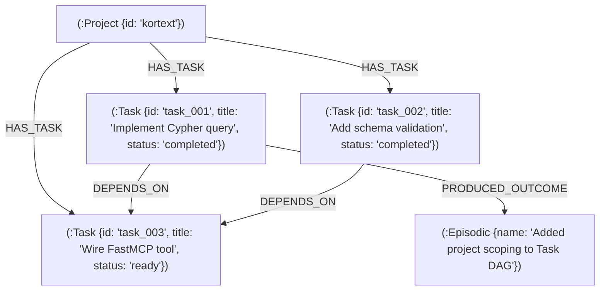

# Kortext Task DAG & Subagent Orchestration Guide

> **Graph-Backed Directed Acyclic Graphs, Subagent Delegation Invariants, and the 5-Round Fix Loop**

---

## 1. The Multi-Agent Execution Paradigm

Single-agent LLM execution fails on non-trivial engineering tasks for predictable reasons:
- **Context Window Saturation:** As turns progress, the accumulated prompt history dilutes attention.
- **Role Confusion:** A single agent attempting to write code, review security, design architecture, and verify test suites simultaneously experiences conflicting objectives.

Kortext implements **Subagent-Driven Development (SDD)**: complex initiatives are decomposed into an isolated **Task DAG** where clean, specialized subagents execute focused leaf tasks in fresh context windows, reporting back to the parent orchestrator.

---

## 2. Graph-Backed Task DAG Architecture

The Task DAG is persisted directly within the FalkorDB graph substrate:



### Task State Machine

Tasks transition through five deterministic states:
1. **`pending`**: Blocked by uncompleted upstream dependencies (`[:DEPENDS_ON]`).
2. **`ready`**: All dependencies are `completed`; ready for subagent execution.
3. **`in_progress`**: Claimed and actively being executed by a subagent.
4. **`completed`**: 100% verified with passing tests and linked to an episodic outcome.
5. **`failed`**: Circuit breaker tripped or test failure after 5 fix rounds.

---

## 3. The Subagent Delegation Invariant

Whenever an engineering initiative modifies **2+ files** or has a **Cognitive Complexity Score $C \ge 4$**, primary agents **MUST NOT** edit code directly in the parent context. They MUST decompose the task into a DAG and delegate execution.

### Complexity Scoring Rubric ($C$)

| Dimension | Points (1-3) |
|:---|:---|
| **Files Affected** | 1 file = 1 pt \| 2-3 files = 2 pts \| 4+ files = 3 pts |
| **Cross-Module Coupling** | Isolated logic = 1 pt \| Imports internal utils = 2 pts \| Crosses sub-packages = 3 pts |
| **Substrate Interaction** | Pure in-memory = 1 pt \| Single substrate (Qdrant or FalkorDB) = 2 pts \| Dual-memory + IPC = 3 pts |
| **Test Requirements** | Unit tests only = 1 pt \| Integration tests = 2 pts \| E2E substrate tests = 3 pts |

**Threshold:** If $C \ge 4$, initialize the Task DAG via `manage_tasks(action='create')` and delegate leaf tasks.

---

## 4. Specialized Subagent Personas

Kortext provides five specialized subagent personas configured in `integrations/antigravity/agents/`:

```
┌────────────────────────────────────────────────────────┐
│                   Primary Orchestrator                 │
└──────────────┬──────────────────────────┬──────────────┘
               │                          │
        Decomposes DAG              Dispatches Leaf
               │                          │
               ▼                          ▼
 ┌──────────────────────────┐    ┌──────────────────────────┐
 │ kortext-architect        │    │ kortext-task-runner      │
 │ (Refactors & Invariants) │    │ (TDD Leaf Worker)        │
 └──────────────────────────┘    └────────────┬─────────────┘
                                              │
                                        Sends Diff
                                              │
                                              ▼
 ┌──────────────────────────┐    ┌──────────────────────────┐
 │ kortext-researcher       │    │ kortext-code-reviewer    │
 │ (Read-Only AST & RAG)    │    │ (Confidence-Filtered QA) │
 └──────────────────────────┘    └────────────┬─────────────┘
                                              │
                                        Audit Gate
                                              │
                                              ▼
                                 ┌──────────────────────────┐
                                 │ kortext-security-auditor │
                                 │ (Red Team & MINJA Gate)  │
                                 └──────────────────────────┘
```

1. **`kortext-task-runner` (Model: `flash` / `inherit`):**
   - Clean execution worker. Takes a single leaf task brief, writes failing tests first (RED), implements minimal code (GREEN), refactors (REFACTOR), and reports verified results.
2. **`kortext-architect` (Model: `pro`):**
   - System architect specialist. Audits architectural invariants, plans multi-stage expand-contract refactors, analyzes AST blast radius, and triggers Louvain community detection.
3. **`kortext-code-reviewer` (Model: `pro`):**
   - Strict reviewer enforcing ECC standards, immutability, typing, and the 200-400 line typical file ceiling with confidence-based filtering (only reports issues with $\ge 80\%$ confidence).
4. **`kortext-security-auditor` (Model: `pro`):**
   - Red Team challenger auditing secret leaks, SQL/Cypher injection parameterization, shell command safety, and MINJA causal memory injection sanitization.
5. **`kortext-researcher` (Model: `flash`):**
   - Read-only AST and dual-memory explorer that traces call paths and surveys code without cluttering the parent context.

---

## 5. The 5-Round Fix Loop with Model Escalation

When a code review or test failure occurs, workers enter a structured fix loop:

| Round | Assigned Agent | Model Tier | Scope / Strategy |
|:---|:---|:---|:---|
| **Round 1-2** | `kortext-task-runner` | `flash` | Direct remediation targeting the specific test assertion or review comment. |
| **Round 3** | `kortext-task-runner` | `flash` | Review surrounding context and caller dependencies via `seek_symbol`. |
| **Round 4** | `kortext-task-runner` | **`pro`** (Escalation) | Fresh reasoning context with full high-capacity model reasoning. |
| **Round 5** | **Circuit Breaker** | N/A | **STOP.** Signal architectural impediment to human partner with systematic debugging report. |

---

## 6. The Delegation Completion Contract

1. **Your final message IS the deliverable:** Never end your turn with *"Waiting for background subagents"*. A spawned task is not a completed task. Ending a turn while children are executing orphans their results.
2. **If you delegate, you own collection:** The orchestrator must wait for child messages, synthesize findings, update the Task DAG via `manage_tasks`, and return the unified deliverable.
3. **Outcome Linking:** Upon task completion, workers link the task directly to the produced episodic outcome:
   ```cypher
   MATCH (t:Task {id: $task_id}), (e:Episodic {name: $episode_name})
   MERGE (t)-[:PRODUCED_OUTCOME]->(e)
   ```
